# Orbiters - N4N0

Orbiters - N4N0 is a free desktop companion for [VRChat](https://hello.vrchat.com/) by the Orbiters project
([orbiters.cc](https://orbiters.cc)). It starts VRChat for you and shows your friends, puts a set of tools beside
VRChat's own menus (on the desktop and in a SteamVR headset), runs **N4N0**, a small companion that floats on your
avatar and answers when you talk to it, takes **3D pictures** of worlds with VRChat's camera, and keeps your
pictures, visited worlds, videos and Unity avatar projects in one place. It works next to the game, through the
interfaces VRChat and SteamVR offer to other programs: it does not modify, inject into or read the memory of VRChat.

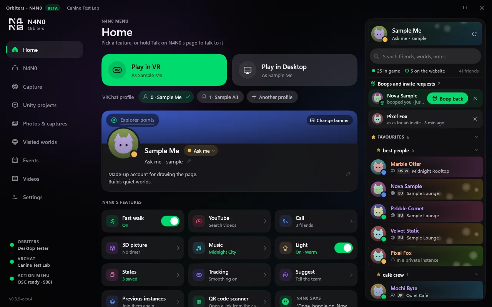

<sub>Every picture in this README is rendered by the app's own screenshot harness with made-up people, worlds and accounts.</sub>

## Contents

- [Download and install](#download-and-install)
- [What it does](#what-it-does)
  - [Start VRChat and see your friends](#start-vrchat-and-see-your-friends)
  - [N4N0, the companion on your avatar](#n4n0-the-companion-on-your-avatar)
  - [Orbiters beside VRChat's menus](#orbiters-beside-vrchats-menus)
  - [VRChat's camera: 3D pictures, recordings and QR codes](#vrchats-camera-3d-pictures-recordings-and-qr-codes)
  - [3D captures, the 3D view and sharing](#3d-captures-the-3d-view-and-sharing)
  - [Photos, visited worlds and videos](#photos-visited-worlds-and-videos)
  - [YouTube and music](#youtube-and-music)
  - [Events](#events)
  - [Unity projects](#unity-projects)
  - [In VR: fast walk, tracking, frame rate, translation](#in-vr-fast-walk-tracking-frame-rate-translation)
  - [Languages and updates](#languages-and-updates)
  - [Coming soon and experimental](#coming-soon-and-experimental)
  - [On a Mac](#on-a-mac)
- [How it works with VRChat, and what it does not do](#how-it-works-with-vrchat-and-what-it-does-not-do)
- [Privacy and network use](#privacy-and-network-use)
- [Building from source](#building-from-source)
- [Project layout](#project-layout)
- [Releases and signing](#releases-and-signing)
- [Code signing policy](#code-signing-policy)
- [Contributing and security](#contributing-and-security)
- [Licence](#licence)
- [Credits](#credits)

## Download and install

Download `OrbitersSetup-<version>.exe` from the
[latest release](https://github.com/Orbiters-cc/Orbiters-N4N0/releases/latest) and run it. It installs for your
Windows user only, in `%LOCALAPPDATA%\Programs\Orbiters - N4N0`, without administrator rights, and adds the app to
Windows' installed apps, so it can be removed from Settings › Apps like any other program. The setup offers a desktop
shortcut, starting with Windows (in the tray) and starting with SteamVR; all three can be changed later in the app's
Settings.

The setup is not code-signed yet, so Windows SmartScreen may warn about it ("Windows protected your PC": More info, then
Run anyway). See [Releases and signing](#releases-and-signing) for how releases are checked today.

| | |
|---|---|
| System | Windows 10 or 11, 64-bit. Recording VRChat's sound on its own (process loopback) needs Windows 11. |
| VRChat | The Steam version, on the same computer, for everything that reads the game (camera, log, overlays). |
| SteamVR | Optional. Needed for the headset features: the overlay in VR, fast walk, tracking smoothing, live translation. |
| Accounts | None required. An Orbiters account adds sharing, events, N4N0's assistant and explorer points. |
| Disk | About 210 MB installed (the setup is about 90 MB). Speech models (about 490 MB) and translation models are downloaded only if you turn those features on. |
| macOS | Apple silicon, development pre-releases only so far: see [On a Mac](#on-a-mac). |

Stable releases are marked *Latest* on the releases page; versions named `-dev.N` are development pre-releases.

## What it does

The window has eight pages: **Home**, **N4N0**, **Unity projects**, **Photos & captures**, **Visited worlds**,
**Events**, **Video history** and **Settings**. Recordings and 3D pictures are started from the capture bar of
Photos & captures. Most of what follows is also reachable inside VRChat,
from the tiles beside its menus or from N4N0's menu.

### Start VRChat and see your friends

Home has **Play in VR** and **Play in Desktop**. Both start VRChat through Steam, as you would, with the launch options
you chose in Settings, and with the VRChat profile you pick (`--profile`) when you use several. Under them is your
profile card (picture, status, bio, banner) and the Explorer points you earned with public 3D pictures.

The friends list in the right column shows who is in game, on the website or offline, grouped as VRChat's favourite
groups, with a search across friends, worlds and notes. Received boops and invite requests come first. A friend's
profile opens in a card with where they are, Join, Request invite and Boop.

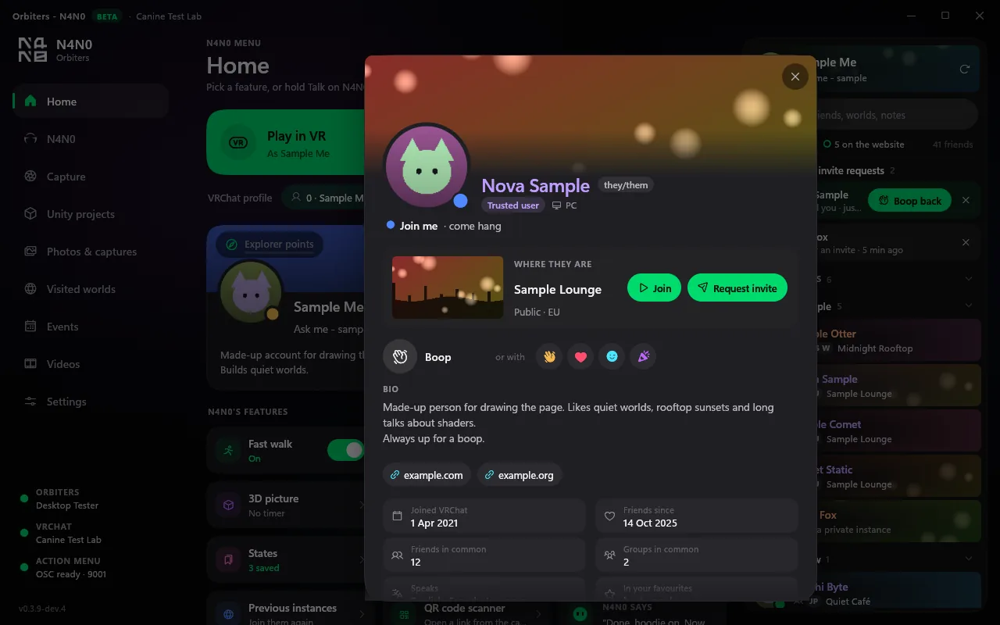

Where the list comes from: without a VRChat sign-in, it reads what [VRCX](https://github.com/vrcx-team/VRCX) or
VRCNext already keep on this computer (read only, nothing is written to their folders). Signing in to VRChat inside
the app is optional and is opened by Orbiters account by account; when it is used, requests go straight to VRChat with
your own session (see [Privacy](#privacy-and-network-use)).

### N4N0, the companion on your avatar

N4N0 is a prop you add to your avatar (Unity projects › **Add N4N0**, or Orbiters' My Avatar tool). In VRChat it floats
by you with a text panel everyone around can read. You talk to it by holding Talk, by touching it, or by starting a
sentence with "Nano"; speech is transcribed **on this computer**, and only the sentences meant for N4N0 go to its
assistant, which runs on Orbiters (a free daily quota). It can put your hoodie on, keep your GoGoLoco pose when you
change avatar, hold parameters that worlds reset, show an AFK message, save the videos a world plays and take
pictures. The N4N0 page can turn the assistant off for a tool without AI.

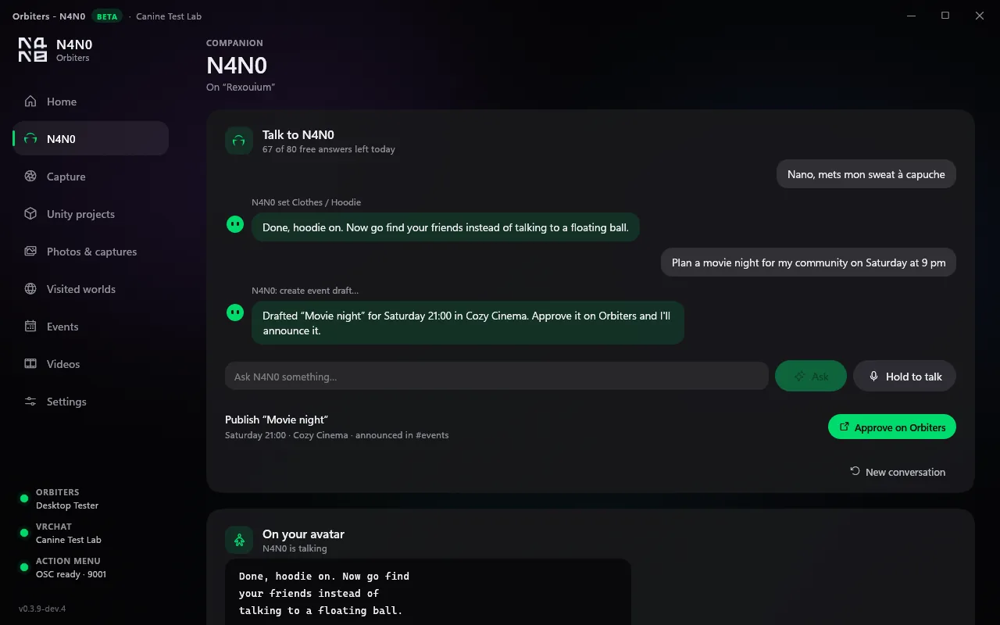

**N4N0's menu** is the same set of features as Home's cards: fast walk, YouTube, a 3D picture with a timer, the music
that plays, N4N0's light, saved avatar states (every parameter OSC can set, saved under a name and put back in one
press), tracking, previous instances, the QR code scanner and suggestions to the team. In VR it opens from a SteamVR
binding (two quick taps on the left thumbrest or trackpad by default), from a watch on your wrist, or from the wake
word; it opens in front of you as a SteamVR overlay, or on N4N0's own screen in the world when your N4N0 has one.

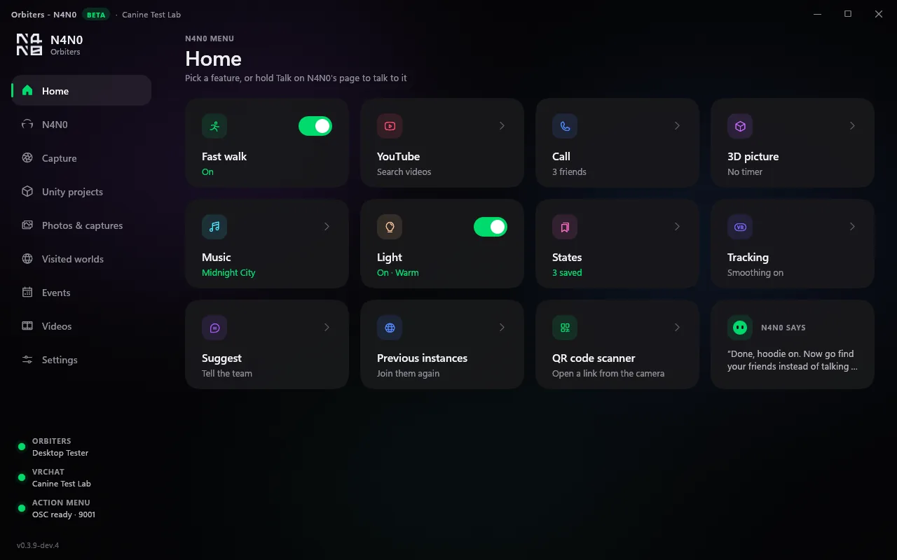

### Orbiters beside VRChat's menus

When VRChat's Quick Menu opens, a column of Orbiters tiles docks beside it: Worlds in 3D, YouTube, Instances,
Pictures, Ask N4N0, All tools and what is playing on the computer. A second ring of cells surrounds the Action Menu's
wheel. They appear when VRChat's menu opens and go when it closes. In desktop mode they are borderless windows over
VRChat's; in VR they are SteamVR overlays riding the hand that opened the menu, pointed at with the other hand's laser.

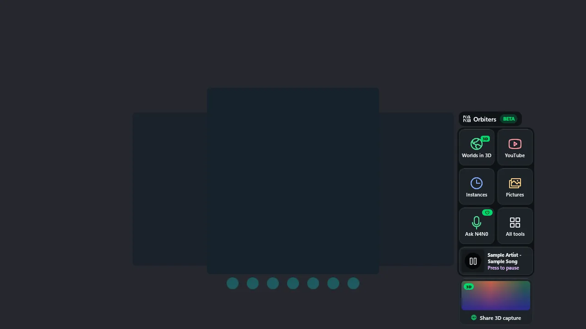

<sub>Desktop form, over a grey stand-in of VRChat's Quick Menu (the harness does not draw VRChat's own menu).</sub>

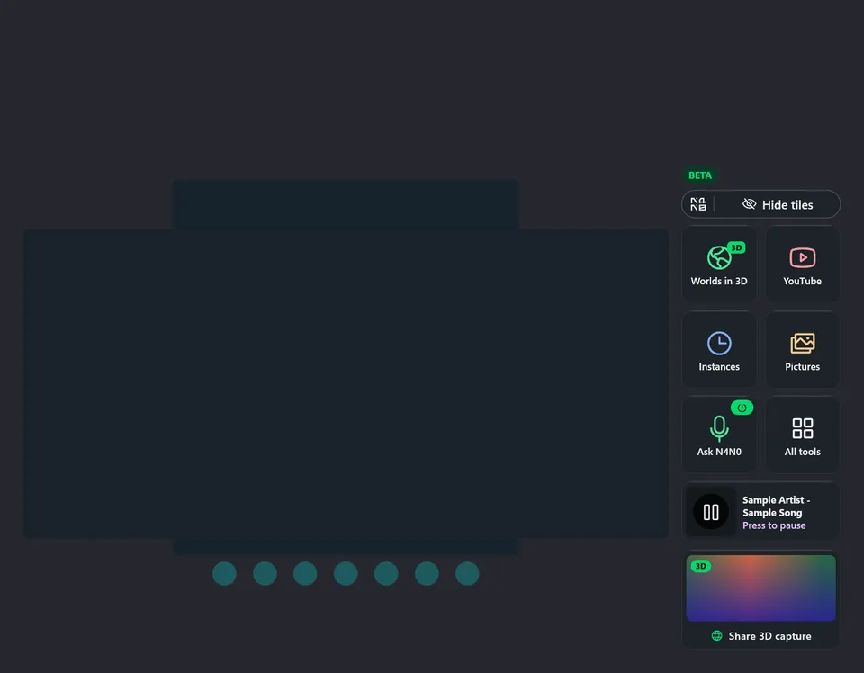

<sub>Headset layout, drawn flat over the same stand-in. In the headset the tiles hang beside the menu on your hand.</sub>

### VRChat's camera: 3D pictures, recordings and QR codes

When VRChat's camera is open, tiles beside it offer **3D of people**, **3D of world** (1, 4 or 8 seconds),
**Record** and **QR code**. A 3D picture flies the camera around you while it records; the app then reconstructs the
place on your graphics card. Pointing the camera at a QR code opens its page: in a headset in a panel above the
camera (an off-screen browser view, with Open in browser), in desktop mode in your browser; styled codes (inverted, coloured, with a logo) are read too.

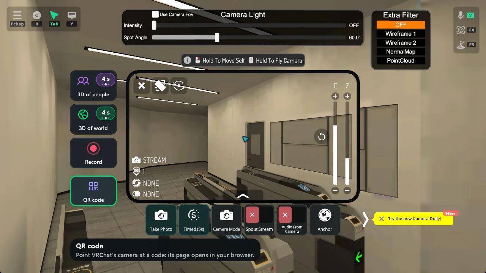

<sub>Desktop mode, painted over a real frame of the game from the repository's test pictures.</sub>

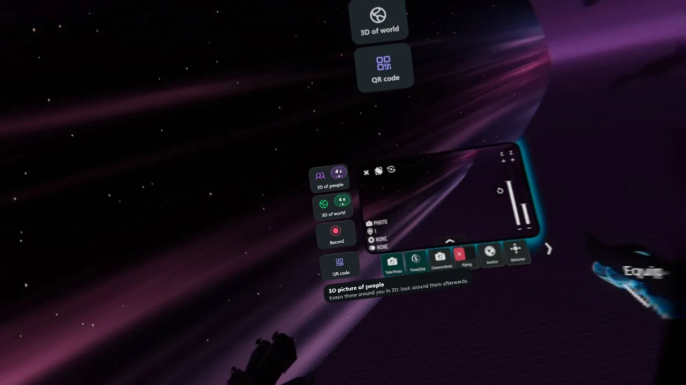

<sub>In a headset: a picture of one eye taken in VRChat, with the tiles where the app's tracker places them.</sub>

3D pictures and recordings need N4N0's **capture kit** on your avatar (added from Unity projects, like N4N0): it draws
a small strip into the camera's picture that carries the camera's exact position and depth. The app reads the camera's
picture over Spout (VRChat's Spout Stream option) and never needs your VRChat login for it.

### 3D captures, the 3D view and sharing

Each recording or 3D picture becomes a capture in Photos & captures. The app trains it into Gaussian splats on your
GPU (`orbiters-reconstruct`), shows it in a 3D view you can orbit, save a view of, edit and select splats in, and
exports it as SPZ or GLB for other tools ([docs/splat-exports.md](docs/splat-exports.md)). Captures can be sent to
Unity through [Mixer](https://github.com/Orbiters-cc/Mixer).

Sharing is your choice, per capture: keep it on this computer, share it with chosen people, or make it public on
Orbiters. Public 3D pictures appear in **Worlds in 3D**, where anyone using the app can search VRChat's worlds, see
which have captures, stand inside one in VR, like, label and comment on worlds. When you arrive in a world that has no
public 3D picture yet, N4N0 says so once (Settings can turn this off), and the first public pictures of a world earn
Explorer points.

<sub>No picture of the 3D view here: it needs a real reconstructed capture, and the README uses made-up data only.</sub>

### Photos, visited worlds and videos

- **Photos & captures**: your VRChat pictures and captures, grouped by world and instance, with pictures shared with
  you and your communities' galleries. A photo editor works on copies (crop, light, colour, curves, blur, text,
  layers of VRChat's multi-layer pictures); the original is never written ([docs/photo-editor.md](docs/photo-editor.md)).
- **Visited worlds**: every world you visited, read from VRChat's own log files and kept after VRChat deletes them,
  with the pictures you took and the sessions you recorded there. **Previous instances** lets you go back.
- **Video history**: every video the worlds' players played, from the same logs, by day, with its link to copy for another
  world's player and lists of bookmarks of your own.

### YouTube and music

YouTube search with suggestions as you type, up to five results a page and **Copy link** to paste in a world's video player;
in VR, a copied link can be dropped in the world as a card others can grab. It reads YouTube the way its website does,
with no account and no key. What plays on the computer (Spotify, a browser, any app that reports to Windows' media
controls) shows with play, pause and next.

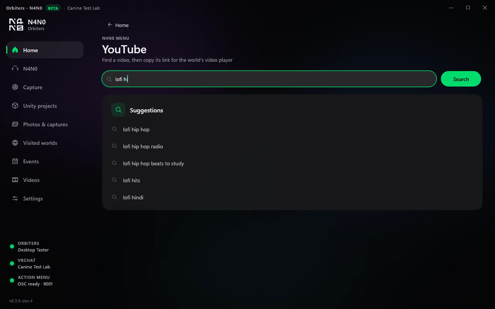

### Events

The Events page lists the events published on Orbiters, soonest first, with the ones happening now on top. An event
opens with its programme step by step, its worlds, its pictures and **Invite me**.

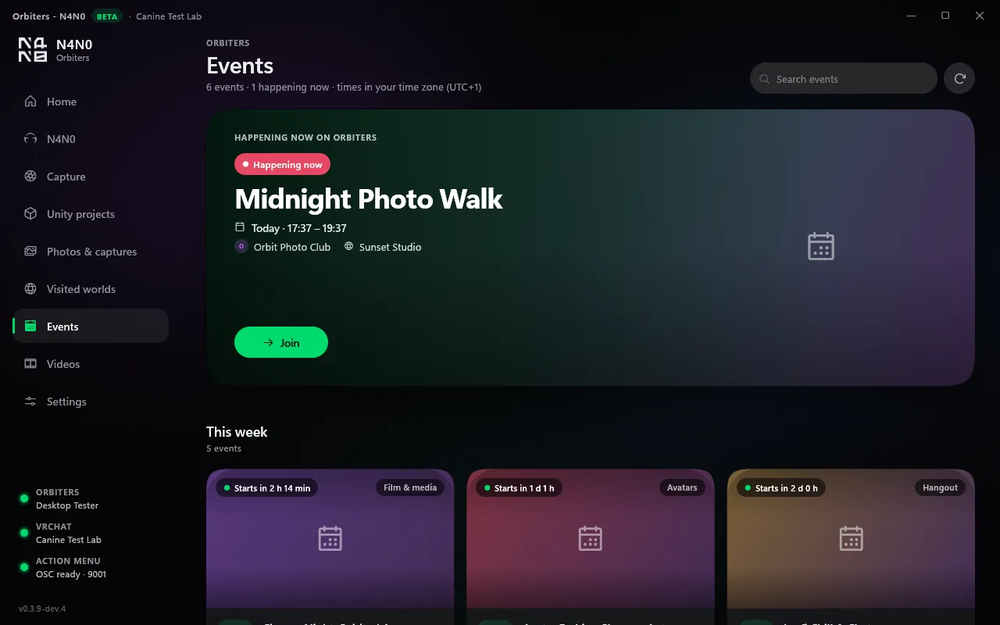

### Unity projects

A manager for VRChat Unity projects that works with the same project list as the VRChat Creator Companion and ALCOM,
without either running: find and add projects, create one from a template, duplicate one with its exact package
versions, open it in Unity, manage VPM packages and repositories, see each project's avatars and disk use, and add
N4N0 or the capture kit to an avatar ([docs/unity-projects.md](docs/unity-projects.md)).

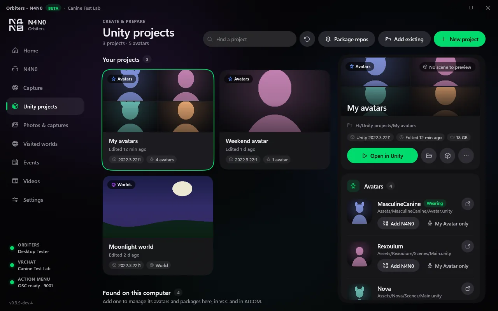

### In VR: fast walk, tracking, frame rate, translation

| Feature | What it does |
|---|---|
| Fast walk | While you walk with the stick, your tracked devices are carried along, so you cover more ground. Strength is a slider. |
| Tracking smoothing | Eases the poses of the headset, controllers and trackers, each with its own strength. |
| FPS booster | One slider, Off · Background · Picture · Avatars. It keeps a change only if measured frames rise, and puts everything back ([docs/fps-booster.md](docs/fps-booster.md)). |
| Live translation | Off by default. Reads the text you see in the headset and lays its translation over it in the room ([docs/translate.md](docs/translate.md)). |
| Sound devices | Switches Windows' default output and input to the headset's while SteamVR runs, and back after. |
| Floating panel and watch | The SteamVR dashboard tab can float beside you while VRChat keeps the controllers; a watch on your wrist opens N4N0's menu. |

Fast walk and tracking smoothing go through the app's SteamVR driver; see
[How it works](#how-it-works-with-vrchat-and-what-it-does-not-do).

### Languages and updates

The whole app is in English, French, Spanish, Brazilian Portuguese and Japanese, the languages of the Orbiters
website. It follows this computer's language, or the one saved on your Orbiters account.

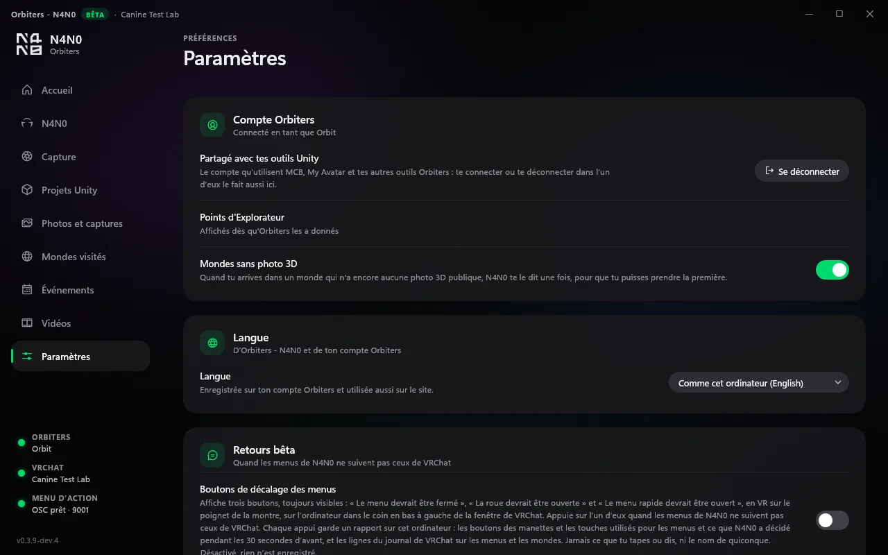

Installed apps look for a new version 45 seconds after they start and every 4 hours, download it in the background,
check it against the signed release, and offer **Restart to update**; a running recording, reconstruction or upload is
never cut by it. Settings › About has **Look now**.

### Coming soon and experimental

- **Calls** between two Orbiters - N4N0 apps appear in the menus but say *Coming soon*: they are not open to accounts yet.
- **VRChat bridge** (experimental, off by default): an [MCP](https://modelcontextprotocol.io/) service that lets an AI
  agent run VRChat in desktop mode in private instances to take 3D pictures. Only the project owner's account can turn
  it on today (the server decides); for everyone else Settings shows nothing and nothing listens. Its rules, and how
  it stands against VRChat's Terms of Service, are in [docs/vrchat-bridge.md](docs/vrchat-bridge.md).

### On a Mac

There are development builds for Macs with Apple silicon (a `.dmg` on some `-dev` pre-releases). VRChat has no Mac
version, so what reads VRChat on the same computer has nothing to read there (the camera over Spout, 3D pictures and
recordings, the log, SteamVR features). The rest works: Unity projects, Photos & captures and their reconstruction, the
3D view and editors, Events, N4N0 and its menu, and OSC with VRChat on another device of the network (a Quest, a Pico,
a phone or a PC on the same Wi-Fi). Play can also start VRChat on the Mac, one at a time, on the VRChat profile you pick,
through `obelisk-cli`, a separate GPL-3.0 program from the [Orbiters-cc/Obelisk](https://github.com/Orbiters-cc/Obelisk)
fork, downloaded from that fork's releases; none of its code is in N4N0.

## How it works with VRChat, and what it does not do

Orbiters - N4N0 talks to VRChat only through what VRChat and SteamVR offer to other programs, plus ordinary Windows
interfaces. Each line below is what the code does; the comments of each module say the same.

| Interface | Used for |
|---|---|
| [OSC and OSCQuery](https://docs.vrchat.com/docs/osc-overview) | Avatar parameters (N4N0, saved states, the capture kit), opening the camera in Stream mode while recording. |
| VRChat's log files (`output_log_*.txt`) | Read only: the current world and instance, who joined, the avatar worn, the videos played. |
| Spout (VRChat's Spout Stream camera option) | The camera's picture for recordings, 3D pictures and the QR code scanner. |
| Steam | Play starts VRChat with `steam -applaunch 438100` and documented launch options, so Easy Anti-Cheat starts as usual. |
| SteamVR (OpenVR) | Overlays for the tiles and panels, controller actions, the compositor's eye picture (camera tiles, translation), the `supersampleScale` setting (FPS booster). |
| The app's SteamVR driver | `driver_orbiters_smooth.dll`, registered with SteamVR at first start and loaded by SteamVR into its own server. It eases device poses for tracking smoothing and adds fast walk's movement. It does nothing until one of those is on. It touches SteamVR's pose pipeline, not VRChat. |
| Windows Graphics Capture | In desktop mode only, small parts of VRChat's window, while a key was just pressed or a menu shows, to know where VRChat's menus and camera are. |
| A low-level mouse hook | In desktop mode only, while Left Alt is held with VRChat's wheel open, so the mouse can point at the ring of tiles. |
| VRChat's web API | Only if you sign in to VRChat in the app (opened per account), with your own session: friends, profiles, invites, boops, instances. |

What it does **not** do:

- No injection into VRChat, no reading or writing of its memory, no handle opened on its process, nothing done to or
  around Easy Anti-Cheat, no files of VRChat's modified.
- The FPS booster never changes VRChat's priority or settings: it changes other programs' priority (Windows'
  efficiency mode) and SteamVR's own setting, records every change before making it, and puts it back, even after a
  crash. VRChat's own graphics settings are listed for you to change in VRChat yourself.
- It does not ask for your VRChat password to work. The optional VRChat sign-in sends it only to VRChat.

## Privacy and network use

What stays on this computer: your recordings and their reconstruction, the VRChat log reading, speech recognition
(NVIDIA Parakeet through sherpa-onnx, on the processor), the friends data read from VRCX or VRCNext, your pictures
unless you share them, and your Unity projects.

What leaves it, and to whom:

| Destination | What is sent | When |
|---|---|---|
| Orbiters (`orbiters.cc`) | Sign-in (a browser pairing; nothing is typed in the app), the update feed and setups | When signed in; update checks always |
| Orbiters | Captures and pictures you share, world likes, labels and comments, explorer points, events and galleries | When you use those features |
| Orbiters | The sentences meant for N4N0 (typed, or transcribed here) and its answers | When the assistant is on and you talk to N4N0 |
| Orbiters | **Beta usage statistics**: which pages and buttons are used and in what order, the app's and the computer's processor, graphics and memory use, VRChat's frame rate in VR, hardware models. Never what you type or say, pictures, links, worlds or people. Linked to your Orbiters account when signed in. | **On by default** during the beta; a notice in the window says so; turning it off in Settings deletes what was waiting |
| Orbiters | Your frame rate per world, with the world, your avatar, the number of people and their avatars' names (never who they are) | Off by default; Settings turns it on |
| Orbiters | The ids of avatars in your Unity projects, for their thumbnails | When you are not signed in to VRChat |
| VRChat's picture servers | Ordinary downloads of public pictures (worlds, avatars, profiles), without any cookie | When a page shows them |
| VRChat (`api.vrchat.cloud`, `files.vrchat.cloud`, `assets.vrchat.com`) | Requests with your own VRChat session | Only if you signed in to VRChat in the app |
| YouTube (`youtube.com`, `suggestqueries.google.com`, `i.ytimg.com`) | Your searches; titles and thumbnails of videos in your history | When you search or open Videos |
| GitHub releases (k2-fsa), Hugging Face | Model downloads (speech, text reading, translation) | Only when you install those models |
| A translation service you choose | The text to translate: an AI server on this computer, one on your network, or Orbiters | Only with live translation on |
| VPM package repositories | Package listings and downloads | On the Unity projects page |
| The page a QR code points to | An ordinary web request, in a private off-screen view (in a headset; your browser in desktop mode) | When you open a scanned code |

Where credentials are kept: the Orbiters sign-in is shared with the Orbiters Unity tools in Unity's preferences folder,
protected with Windows' DPAPI for your Windows user. The optional VRChat session keeps only VRChat's `auth` and
`twoFactorAuth` cookies, DPAPI-protected, in `%LOCALAPPDATA%\Orbiters\vrchat-session.bin`; passwords and codes are
never stored ([docs/vrchat-sign-in.md](docs/vrchat-sign-in.md)). The uninstaller can remove settings, caches and models
too; your recordings are never removed by it.

## Building from source

Requirements:

- Rust stable with the MSVC toolchain on Windows (Xcode's command line tools on a Mac).
- CMake 3.x on the `PATH` (the calls worker compiles the Opus codec).
- Access to the `contracts` submodule, [Orbiters-cc/OrbitersContracts](https://github.com/Orbiters-cc/OrbitersContracts),
  the formats shared with Mixer. **It is a private repository today: without access the workspace does not build.**

```sh
git clone https://github.com/Orbiters-cc/Orbiters-N4N0.git
cd Orbiters-N4N0
git submodule update --init
cargo build --release -p orbiters-desktop -p orbiters-capture -p orbiters-reconstruct -p orbiters-voice -p orbiters-call
target/release/orbiters-desktop
```

The app looks for its workers (`orbiters-capture`, `orbiters-reconstruct`, `orbiters-voice`, `orbiters-call`) next
to its own executable. Building `orbiters-voice` downloads sherpa-onnx's prebuilt libraries (about 8 MB, from
k2-fsa's GitHub releases) and places them next to it. `orbiters-desktop --hidden` starts in the tray, `--quit` stops it.

Tests and lints:

```sh
cargo test --workspace
cargo clippy --workspace --all-targets
```

Tests never touch the person's own folders, the registry, VRChat or the network: they run on temporary folders and
recorded replies. The interface can be reviewed without a window: `orbiters-desktop --screenshot <out folder>
[--only <scenario>] [--language <tag>]` renders pages offscreen with made-up data (this README's pictures were made
so). After a dependency change, regenerate the licence file with `python scripts/third_party_licenses.py`.

More: [docs/releasing.md](docs/releasing.md) (releases), [docs/vr-sandbox.md](docs/vr-sandbox.md) (the SteamVR test
sandbox), and the other notes in [docs/](docs/).

## Project layout

| Path | What it is |
|---|---|
| `crates/orbiters-desktop` | The app: the tray service (VRChat watchers, OSC, workers), the window, the SteamVR and desktop overlays |
| `crates/orbiters-ui` | The interface toolkit: theme, fonts, widgets, animations, offscreen and CPU painters |
| `crates/orbiters-core` | Shared logic: settings, VRChat log, OSC/OSCQuery, the Orbiters and VRChat API clients, credential storage |
| `crates/orbiters-i18n` | Every text of the app in its five languages |
| `crates/orbiters-capture` | Capture worker: Spout frames, the capture kit's strip and depth, session bundles |
| `crates/orbiters-reconstruct` | Reconstruction worker: Gaussian splats trained on the GPU (WGSL on wgpu) |
| `crates/orbiters-n4n0`, `orbiters-n4n0-core`, `orbiters-n4n0-mobile` | N4N0: its runtime, menu, assistant client, saved states; the phone core |
| `crates/orbiters-voice` | Speech worker: voice detection and transcription on the CPU (sherpa-onnx) |
| `crates/orbiters-call` | Calls worker (WebRTC, Opus); calls are not open yet |
| `crates/orbiters-audio`, `orbiters-sound` | Microphones and process audio (WASAPI); the interface's sounds |
| `crates/orbiters-openvr` | A minimal SteamVR client: poses, overlays, input, mirror textures |
| `crates/orbiters-smooth`, `orbiters-smooth-driver` | Tracking smoothing and fast walk: the shared control block and the SteamVR driver |
| `crates/orbiters-booster` | The FPS booster's logic and its undo journal |
| `crates/orbiters-qr`, `orbiters-translate`, `orbiters-web` | QR reading, live translation (OCR and placement), private off-screen web pages |
| `crates/orbiters-projects` | Unity projects, VPM packages, templates, avatar setup |
| `crates/orbiters-spout` | Spout2 receiver and test sender (Direct3D 11) |
| `crates/orbiters-setup`, `orbiters-update`, `orbiters-version` | The setup and uninstaller, signed releases and updates, the version |
| `xtask/` | Release tooling: `cargo xtask keygen / bump / dist / publish / release / github` |
| `contracts/` | Submodule: formats shared with Mixer (private, see [Building](#building-from-source)) |

## Releases and signing

Releases are built on the maintainer's computer with `cargo xtask release`, not on a hosted CI. Each version is tagged
`desktop-v<version>` and published on the [releases page](https://github.com/Orbiters-cc/Orbiters-N4N0/releases) with
its setup, and on orbiters.cc for installed apps ([docs/releasing.md](docs/releasing.md)).

How a release is checked today:

- **Updates are signed.** Each release is described by a file signed with the project's Ed25519 release key; the
  public half (`crates/orbiters-update/update-key.pub`) is built into every app. An installed app checks that
  signature, then the setup's size and SHA-256, before installing anything. The server holds no key, so a compromised
  server cannot make an app install anything.
- **The setup checks itself.** It holds a compressed payload whose index lists each file's size and SHA-256, unpacks
  and checks it before moving files into place, and puts the old files back if a move fails.
- **The setup and programs are not Authenticode-signed yet.** GitHub shows each asset's SHA-256 digest on the release
  page; a downloaded setup can be compared with `Get-FileHash OrbitersSetup-<version>.exe`.

## Code signing policy

Windows code signing (Authenticode) of the programs and the setup is not in place yet; when it is, this section will
name the service and certificate used. Until then, only the update signature above applies.

| Role | Who |
|---|---|
| Committers and reviewers | [Members of the Orbiters-cc organisation](https://github.com/orgs/Orbiters-cc/people) |
| Approvers (who decide that a release is published and signed) | [Owners of the Orbiters-cc organisation](https://github.com/orgs/Orbiters-cc/people?query=role%3Aowner) |

The project has one maintainer today, who holds all three roles. Contributions from anyone else are reviewed by the
maintainer before they are merged.

Privacy: what the program sends over the network, and to whom, is in [Privacy and network use](#privacy-and-network-use).

## Contributing and security

Issues and pull requests are welcome on [GitHub](https://github.com/Orbiters-cc/Orbiters-N4N0/issues). Note the
licence below: contributions are accepted, but the code may not be reused or redistributed without permission.

Please report security problems privately rather than in a public issue, through the maintainer's GitHub profile or
[orbiters.cc](https://orbiters.cc), and give enough to reproduce them.

## Licence

Orbiters - N4N0 is **free to use with readable source, but not open source**: it is under the proprietary
[Orbiters Desktop Licence](LICENSE.md). You may download and use unmodified copies from the official channels, read
the source, and make tools that talk to it with attribution; copying, modifying or redistributing it needs written
permission. Copyright (c) 2026 Enzo DUTRA / blackorbit.

Third-party components keep their own licences: see [THIRD_PARTY_NOTICES.md](THIRD_PARTY_NOTICES.md) and the full
texts in [THIRD_PARTY_LICENSES.md](THIRD_PARTY_LICENSES.md), both shipped with the app. Recording what VRChat shows
comes with responsibilities toward world creators and other players, which the licence states.

## Credits

Built on [egui](https://github.com/emilk/egui) and [wgpu](https://github.com/gfx-rs/wgpu),
[sherpa-onnx](https://github.com/k2-fsa/sherpa-onnx) with Silero VAD and NVIDIA Parakeet,
[ONNX Runtime](https://onnxruntime.ai/), PaddleOCR's models, [webrtc-rs](https://github.com/webrtc-rs/webrtc),
[vrc-get](https://github.com/vrc-get/vrc-get) (ALCOM's VPM resolver), the
[Spout2](https://github.com/leadedge/Spout2) protocol and [Phosphor Icons](https://phosphoricons.com/), among the
components listed in [THIRD_PARTY_NOTICES.md](THIRD_PARTY_NOTICES.md). VRChat is a trademark of VRChat Inc.; this
project is not affiliated with or endorsed by VRChat Inc. or Valve.
