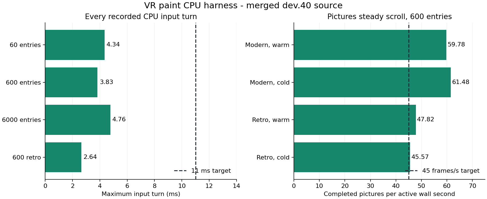

# Current review handoff

Measured application source: `ca1b2791dfda5b2c1accdd2cb092124be856b520` on `vr1111/paint`, including local main `dc1ef14b718501088354a680d3b5492aa1a377dc` (dev.40). All six review findings are addressed. The final CPU harness gates **pass**: maximum input turn **4.762 ms** across modern 60/600/6000 and retro 600 cases; visited-page pictures restore on the next turn in **48/48** checks per case; 600-entry steady-scroll rates and the 45 frames/s threshold are reported separately for modern and retro. Exact controlled settled pixels and matching geometry pass without tolerance. The complete merged desktop suite passes **931 tests**, with 25 existing ignored tests.

These are CPU results, not a measured bound for physical controller/walk/pose work, D3D upload or headset delivery. The final documentation commit changes only this report and its CPU chart. Nothing was pushed or released.

The original report below is preserved as historical evidence, including its partial-result verdict. The appended **Review fixes** section supersedes that verdict and contains the final before/after tables, failures and corrections, memory, screenshots and verification limits.

---

# VR1111 paint - F11/F12 implementation and evidence

Final handoff head: `f96fe5c8214bf1de3ee53e42a3d41deee66dd74a`. The final commit adds only the report; measured application sources are unchanged from `9130d7518393c036de513b562c10fca6f8d0e9b4`. The committed report is `docs/vr1111-paint.md`.
Measured merged code head: `9130d7518393c036de513b562c10fca6f8d0e9b4` on `vr1111/paint`. Main `d17dabc9d15c0c50ae6415ec5442f9e301bddb22` is an ancestor (merge `7b201c8d3005c4dee62f1fc728f443225d777128`).

**Partial result; acceptance remains blocked.** Ordinary-page painting is isolated from input on a bounded worker, cached pages restore their pixels and hit geometry on the next turn, and the single composed sheet is preserved. Full requirements are not declared complete: MenuHost/Worlds remain synchronous and exact full-replay frame hashes differ. No headset, upload or GPU measurement is claimed.

- F11 final 600-entry warm-scroll cadence: **56.70 frames/s**, against 45. Worst measured gallery input turn across the three sizes and warm/cold motions: **4.623 ms**, against 11.
- F12 worst measured switch input turn: **19.424 ms**, `switch-1-Worlds`, against 11. The tables below retain all slow samples.
- Exact raw-part parity: **702/783** common captured frames identical. This is an exact failure if those counts differ; no visual tolerance substitutes for the required unchanged hashes.


Measured status: see target table below. These are CPU harness measurements, not headset validation. No upload/GPU benchmark, installed-app launch, SteamVR/VRChat manipulation, push, release or version bump was performed.

## Before changes

Original 1760x990 measurements were recorded before implementation in paint-before-{60,600,6000}. The 60-entry steady-scroll raster phase was 53.508/56.775/57.957/59.238 ms (p50/p95/p99/max), versus 0.235/0.357/0.563/0.632 ms text/layout, 0.106/0.212/0.282/0.387 ms tessellation/textures, and 0.635/0.875/0.889/1.431 ms finish/copy. Raster dominated; this selected a bounded latest-only CPU worker with parallel independent raster rows. No strip-rendering rewrite was added.

The original baseline did not separately reset decoded thumbnails for a controlled cold-scroll/cold-fling matrix. That gap is explicit. Final controlled before/after below uses the same merged executable and corrected script: --sync serial reference versus normal worker, at the merged shell's 1408x792 page size. It includes the Recents and source-identity fixes in both modes, so it isolates pipeline execution rather than reproducing all old behavior. Original and merged timings must not be compared as if resolution were unchanged.

## Final merged measurement conditions

Intel Core i7-12700K, 12 cores/20 logical processors; opt-level-2 dev build through deskcargo, shared target and CARGO_INCREMENTAL=0. One logged replay plus one timing run per case. Steady scroll and fling each run with warm and reset in-memory thumbnails, at 60/600/6000 entries. The synthetic fixture has 60 unique 640x360 pictures, hardlinked to unique entry paths for larger lists. Cold resets decoded/egui thumbnails, not OS filesystem caches. The machine remained in normal use; other streams could compile. No samples are discarded for slow scheduling.

Input turn = set_open + follow/menu_turn/springs + hand actions + synchronous paint/copy/composition. Eleven-ms pacing sleep is excluded from input cost and included in cadence wall time. Actual controllers, walk, poses, D3D upload and headset delivery are absent. VR header/back and page are composed on CPU into the same single picture as OrbitVr; composition is measured in finish/copy. All frames accepted from a worker carry full-page damage because a skipped frame's incremental damage cannot safely describe the displayed image.

## Final before/after input turns

Each cell gives p50 / p95 / p99 / max milliseconds. No threshold is relaxed.

| Entries | Motion | Serial p50 | p95 | p99 | max | Worker p50 | p95 | p99 | max |
|---:|---|---:|---:|---:|---:|---:|---:|---:|---:|
| 60 | pictures-cold-ingestion-scroll | 37.435 | 40.034 | 41.885 | 44.329 | 2.146 | 2.720 | 3.236 | 3.796 |
| 60 | pictures-cold-ingestion-fling | 44.477 | 56.035 | 65.332 | 65.353 | 1.975 | 2.492 | 2.739 | 3.046 |
| 60 | qm-sheet-pictures-scroll | 58.336 | 73.884 | 80.893 | 82.207 | 2.132 | 2.627 | 3.651 | 3.888 |
| 60 | pictures-fling | 40.650 | 49.890 | 51.978 | 51.984 | 2.052 | 2.524 | 2.716 | 3.581 |
| 600 | pictures-cold-ingestion-scroll | 37.054 | 39.880 | 41.710 | 43.310 | 2.275 | 3.712 | 3.950 | 4.485 |
| 600 | pictures-cold-ingestion-fling | 37.230 | 39.152 | 41.227 | 41.897 | 2.877 | 3.922 | 4.278 | 4.623 |
| 600 | qm-sheet-pictures-scroll | 37.288 | 43.059 | 50.624 | 50.646 | 2.045 | 2.517 | 3.126 | 3.475 |
| 600 | pictures-fling | 37.503 | 40.638 | 42.990 | 45.592 | 1.993 | 2.419 | 2.733 | 3.052 |
| 6000 | pictures-cold-ingestion-scroll | 35.895 | 38.242 | 38.726 | 39.671 | 2.147 | 2.456 | 2.491 | 2.704 |
| 6000 | pictures-cold-ingestion-fling | 36.917 | 38.918 | 40.236 | 40.325 | 2.181 | 2.545 | 2.835 | 3.510 |
| 6000 | qm-sheet-pictures-scroll | 36.428 | 38.327 | 40.834 | 41.019 | 2.127 | 2.429 | 2.647 | 2.789 |
| 6000 | pictures-fling | 36.325 | 37.805 | 39.492 | 39.693 | 2.228 | 2.627 | 3.179 | 3.959 |

## Completed steady-scroll frames

| Entries | Serial frames/s | Worker frames | Active wall seconds | Worker frames/s |
|---:|---:|---:|---:|---:|
| 60 | 13.45 | 78 | 1.365 | 57.13 |
| 600 | 19.43 | 77 | 1.358 | 56.70 |
| 6000 | 20.10 | 73 | 1.367 | 53.39 |

## Per-phase steady-scroll timings

| Entries | Mode | Phase | p50 | p95 | p99 | max ms |
|---:|---|---|---:|---:|---:|---:|
| 60 | serial input | follow_ms | 0.110 | 0.265 | 1.453 | 2.186 |
| 60 | serial input | facts_items_ms | 0.046 | 0.114 | 0.378 | 2.149 |
| 60 | serial input | text_ms | 0.389 | 0.955 | 1.761 | 2.097 |
| 60 | serial input | tess_ms | 0.184 | 0.477 | 1.347 | 2.511 |
| 60 | serial input | raster_ms | 54.176 | 68.680 | 77.096 | 77.790 |
| 60 | serial input | finish_ms | 3.005 | 5.032 | 8.088 | 8.520 |
| 60 | worker input | follow_ms | 0.079 | 0.105 | 0.136 | 0.147 |
| 60 | worker input | facts_items_ms | 0.060 | 0.090 | 0.107 | 0.108 |
| 60 | worker input | text_ms | 0.064 | 0.114 | 0.166 | 0.188 |
| 60 | worker input | tess_ms | 0.037 | 0.057 | 0.093 | 0.125 |
| 60 | worker input | raster_ms | 0.039 | 0.055 | 0.065 | 0.089 |
| 60 | worker input | finish_ms | 1.549 | 1.932 | 3.006 | 3.114 |
| 60 | completed worker | worker_items_ms | 0.005 | 0.018 | 0.033 | 0.033 |
| 60 | completed worker | worker_text_ms | 0.258 | 0.386 | 0.573 | 0.573 |
| 60 | completed worker | worker_tess_ms | 0.103 | 0.148 | 0.163 | 0.163 |
| 60 | completed worker | worker_raster_ms | 10.714 | 14.555 | 15.383 | 15.383 |
| 60 | completed worker | worker_finish_ms | 0.792 | 1.033 | 1.283 | 1.283 |
| 600 | serial input | follow_ms | 0.082 | 0.120 | 0.267 | 0.331 |
| 600 | serial input | facts_items_ms | 0.032 | 0.051 | 0.120 | 0.203 |
| 600 | serial input | text_ms | 0.245 | 0.382 | 0.433 | 0.647 |
| 600 | serial input | tess_ms | 0.114 | 0.200 | 0.314 | 0.444 |
| 600 | serial input | raster_ms | 35.265 | 40.805 | 46.760 | 48.463 |
| 600 | serial input | finish_ms | 1.535 | 2.254 | 3.162 | 3.409 |
| 600 | worker input | follow_ms | 0.084 | 0.117 | 0.145 | 0.148 |
| 600 | worker input | facts_items_ms | 0.052 | 0.083 | 0.134 | 0.138 |
| 600 | worker input | text_ms | 0.063 | 0.108 | 0.184 | 0.187 |
| 600 | worker input | tess_ms | 0.036 | 0.059 | 0.091 | 0.095 |
| 600 | worker input | raster_ms | 0.040 | 0.053 | 0.066 | 0.073 |
| 600 | worker input | finish_ms | 1.525 | 1.970 | 2.546 | 2.594 |
| 600 | completed worker | worker_items_ms | 0.006 | 0.013 | 0.029 | 0.029 |
| 600 | completed worker | worker_text_ms | 0.241 | 0.389 | 0.528 | 0.528 |
| 600 | completed worker | worker_tess_ms | 0.101 | 0.163 | 0.194 | 0.194 |
| 600 | completed worker | worker_raster_ms | 10.799 | 13.410 | 14.357 | 14.357 |
| 600 | completed worker | worker_finish_ms | 0.771 | 0.980 | 1.310 | 1.310 |
| 6000 | serial input | follow_ms | 0.110 | 0.132 | 0.141 | 0.149 |
| 6000 | serial input | facts_items_ms | 0.037 | 0.044 | 0.051 | 0.088 |
| 6000 | serial input | text_ms | 0.241 | 0.334 | 0.395 | 0.435 |
| 6000 | serial input | tess_ms | 0.110 | 0.146 | 0.204 | 0.216 |
| 6000 | serial input | raster_ms | 34.516 | 36.467 | 38.468 | 38.958 |
| 6000 | serial input | finish_ms | 1.339 | 1.621 | 2.173 | 2.199 |
| 6000 | worker input | follow_ms | 0.125 | 0.171 | 0.201 | 0.225 |
| 6000 | worker input | facts_items_ms | 0.058 | 0.122 | 0.130 | 0.149 |
| 6000 | worker input | text_ms | 0.063 | 0.133 | 0.151 | 0.152 |
| 6000 | worker input | tess_ms | 0.037 | 0.082 | 0.108 | 0.122 |
| 6000 | worker input | raster_ms | 0.039 | 0.052 | 0.055 | 0.061 |
| 6000 | worker input | finish_ms | 1.539 | 1.858 | 1.919 | 1.939 |
| 6000 | completed worker | worker_items_ms | 0.008 | 0.017 | 0.043 | 0.043 |
| 6000 | completed worker | worker_text_ms | 0.238 | 0.401 | 0.429 | 0.429 |
| 6000 | completed worker | worker_tess_ms | 0.104 | 0.131 | 0.175 | 0.175 |
| 6000 | completed worker | worker_raster_ms | 10.595 | 11.501 | 12.913 | 12.913 |
| 6000 | completed worker | worker_finish_ms | 0.746 | 0.893 | 0.992 | 0.992 |

## Rapid switches, including A-B-A

| Entries | Page | Serial first turn ms | Worker first turn ms |
|---:|---|---:|---:|
| 60 | All | 20.661 | 3.241 |
| 60 | Pictures | 30.474 | 4.742 |
| 60 | Settings | 16.375 | 3.954 |
| 60 | Tracking | 8.353 | 3.729 |
| 60 | Mics | 11.079 | 3.427 |
| 60 | Booster | 8.788 | 2.085 |
| 60 | Talk | 11.119 | 2.302 |
| 60 | Instances | 10.928 | 3.729 |
| 60 | Results | 8.874 | 3.363 |
| 60 | Menu | 10.584 | 5.220 |
| 60 | Worlds | 50.964 | 18.760 |
| 60 | Pictures | 27.379 | 3.166 |
| 600 | All | 11.833 | 2.930 |
| 600 | Pictures | 19.391 | 3.970 |
| 600 | Settings | 10.049 | 3.421 |
| 600 | Tracking | 4.976 | 3.631 |
| 600 | Mics | 6.656 | 3.583 |
| 600 | Booster | 5.034 | 2.433 |
| 600 | Talk | 7.129 | 2.412 |
| 600 | Instances | 4.879 | 3.579 |
| 600 | Results | 5.219 | 3.975 |
| 600 | Menu | 8.194 | 5.650 |
| 600 | Worlds | 19.442 | 19.424 |
| 600 | Pictures | 14.605 | 3.460 |
| 6000 | All | 11.043 | 3.624 |
| 6000 | Pictures | 17.217 | 3.940 |
| 6000 | Settings | 8.856 | 3.498 |
| 6000 | Tracking | 4.532 | 3.502 |
| 6000 | Mics | 6.056 | 3.506 |
| 6000 | Booster | 4.690 | 2.103 |
| 6000 | Talk | 6.340 | 2.676 |
| 6000 | Instances | 4.800 | 3.703 |
| 6000 | Results | 4.278 | 3.692 |
| 6000 | Menu | 4.681 | 5.285 |
| 6000 | Worlds | 17.986 | 19.372 |
| 6000 | Pictures | 14.601 | 3.607 |

| Entries | Ordinary-page next-turn pictures identical to last captured valid page |
|---:|---:|
| 60 | 10/10 |
| 600 | 10/10 |
| 6000 | 10/10 |

## Targets

| Entries | Gallery maximum input ms | Switch maximum input ms | Worst switch |
|---:|---:|---:|---|
| 60 | 3.888 | 18.760 | switch-1-Worlds |
| 600 | 4.623 | 19.424 | switch-1-Worlds |
| 6000 | 3.959 | 19.372 | switch-1-Worlds |


## Rapid-switch first-turn phase distribution

All 24 first turns (12 cold/refresh switches, 12 visited switches) per size, with the opening action included. Worker phase rows use accepted native-page completions over the full switch steps, including their refresh/rest turns; they are separate work, not added to input-turn time. Per-page first-turn values are above; complete per-step histograms are in each case report.

| Entries | Mode/sample | Phase | p50 | p95 | p99 | max ms |
|---:|---|---|---:|---:|---:|---:|
| 60 | serial first turns | turn | 12.453 | 30.474 | 50.964 | 50.964 |
| 60 | serial first turns | facts_items_ms | 0.023 | 0.038 | 0.043 | 0.043 |
| 60 | serial first turns | text_ms | 1.012 | 4.721 | 4.779 | 4.779 |
| 60 | serial first turns | tess_ms | 0.201 | 0.627 | 1.252 | 1.252 |
| 60 | serial first turns | raster_ms | 5.935 | 24.266 | 45.014 | 45.014 |
| 60 | serial first turns | finish_ms | 3.918 | 8.230 | 9.746 | 9.746 |
| 60 | worker first turns | turn | 3.954 | 14.122 | 18.760 | 18.760 |
| 60 | worker first turns | facts_items_ms | 0.026 | 0.040 | 0.056 | 0.056 |
| 60 | worker first turns | text_ms | 0.221 | 1.762 | 3.689 | 3.689 |
| 60 | worker first turns | tess_ms | 0.058 | 0.289 | 0.333 | 0.333 |
| 60 | worker first turns | raster_ms | 1.413 | 6.127 | 16.485 | 16.485 |
| 60 | worker first turns | finish_ms | 1.897 | 7.217 | 9.322 | 9.322 |
| 60 | accepted switch refreshes | worker_items_ms | 0.004 | 0.008 | 0.009 | 0.009 |
| 60 | accepted switch refreshes | worker_text_ms | 0.223 | 2.819 | 4.474 | 4.474 |
| 60 | accepted switch refreshes | worker_tess_ms | 0.106 | 0.261 | 1.056 | 1.056 |
| 60 | accepted switch refreshes | worker_raster_ms | 1.206 | 10.589 | 12.711 | 12.711 |
| 60 | accepted switch refreshes | worker_finish_ms | 0.737 | 0.842 | 1.317 | 1.317 |
| 600 | serial first turns | turn | 10.049 | 19.391 | 19.442 | 19.442 |
| 600 | serial first turns | facts_items_ms | 0.017 | 0.030 | 0.038 | 0.038 |
| 600 | serial first turns | text_ms | 0.675 | 4.466 | 5.414 | 5.414 |
| 600 | serial first turns | tess_ms | 0.151 | 0.606 | 1.122 | 1.122 |
| 600 | serial first turns | raster_ms | 4.969 | 16.086 | 17.008 | 17.008 |
| 600 | serial first turns | finish_ms | 1.974 | 3.748 | 3.750 | 3.750 |
| 600 | worker first turns | turn | 4.148 | 12.075 | 19.424 | 19.424 |
| 600 | worker first turns | facts_items_ms | 0.024 | 0.039 | 0.053 | 0.053 |
| 600 | worker first turns | text_ms | 0.223 | 1.973 | 2.850 | 2.850 |
| 600 | worker first turns | tess_ms | 0.059 | 0.322 | 0.386 | 0.386 |
| 600 | worker first turns | raster_ms | 1.508 | 5.274 | 16.959 | 16.959 |
| 600 | worker first turns | finish_ms | 1.899 | 6.526 | 7.039 | 7.039 |
| 600 | accepted switch refreshes | worker_items_ms | 0.004 | 0.013 | 0.025 | 0.025 |
| 600 | accepted switch refreshes | worker_text_ms | 0.217 | 2.258 | 4.588 | 4.588 |
| 600 | accepted switch refreshes | worker_tess_ms | 0.110 | 0.324 | 1.051 | 1.051 |
| 600 | accepted switch refreshes | worker_raster_ms | 1.030 | 11.072 | 12.327 | 12.327 |
| 600 | accepted switch refreshes | worker_finish_ms | 0.765 | 0.839 | 0.951 | 0.951 |
| 6000 | serial first turns | turn | 8.856 | 17.730 | 17.986 | 17.986 |
| 6000 | serial first turns | facts_items_ms | 0.015 | 0.032 | 0.065 | 0.065 |
| 6000 | serial first turns | text_ms | 0.634 | 3.993 | 4.793 | 4.793 |
| 6000 | serial first turns | tess_ms | 0.134 | 0.788 | 1.083 | 1.083 |
| 6000 | serial first turns | raster_ms | 4.834 | 14.874 | 15.900 | 15.900 |
| 6000 | serial first turns | finish_ms | 1.680 | 3.190 | 3.349 | 3.349 |
| 6000 | worker first turns | turn | 3.940 | 11.830 | 19.372 | 19.372 |
| 6000 | worker first turns | facts_items_ms | 0.029 | 0.039 | 0.051 | 0.051 |
| 6000 | worker first turns | text_ms | 0.208 | 2.086 | 2.687 | 2.687 |
| 6000 | worker first turns | tess_ms | 0.061 | 0.312 | 0.337 | 0.337 |
| 6000 | worker first turns | raster_ms | 1.373 | 5.516 | 16.809 | 16.809 |
| 6000 | worker first turns | finish_ms | 1.875 | 7.535 | 8.159 | 8.159 |
| 6000 | accepted switch refreshes | worker_items_ms | 0.008 | 0.013 | 0.021 | 0.021 |
| 6000 | accepted switch refreshes | worker_text_ms | 0.227 | 2.496 | 4.669 | 4.669 |
| 6000 | accepted switch refreshes | worker_tess_ms | 0.146 | 0.256 | 1.135 | 1.135 |
| 6000 | accepted switch refreshes | worker_raster_ms | 1.138 | 11.814 | 12.866 | 12.866 |
| 6000 | accepted switch refreshes | worker_finish_ms | 0.815 | 1.115 | 1.359 | 1.359 |

## Cold-scroll and fling phase distributions

Warm steady-scroll phases are above. These rows complete all requested gallery motions. Input phases are per turn; completed-worker phases include only accepted frames. Facts/items are measured directly; the enclosing follow/paint timings and any uncategorized bookkeeping remain in raw CSVs.

| Entries | Motion | Mode/sample | Phase | p50 | p95 | p99 | max ms |
|---:|---|---|---|---:|---:|---:|---:|
| 60 | pictures-cold-ingestion-scroll | serial input | facts_items_ms | 0.031 | 0.039 | 0.043 | 0.044 |
| 60 | pictures-cold-ingestion-scroll | serial input | text_ms | 0.253 | 0.376 | 0.470 | 0.513 |
| 60 | pictures-cold-ingestion-scroll | serial input | tess_ms | 0.114 | 0.210 | 0.262 | 0.294 |
| 60 | pictures-cold-ingestion-scroll | serial input | raster_ms | 35.351 | 37.853 | 39.498 | 42.325 |
| 60 | pictures-cold-ingestion-scroll | serial input | finish_ms | 1.559 | 1.883 | 2.069 | 2.147 |
| 60 | pictures-cold-ingestion-scroll | worker input | facts_items_ms | 0.048 | 0.076 | 0.118 | 0.119 |
| 60 | pictures-cold-ingestion-scroll | worker input | text_ms | 0.061 | 0.112 | 0.172 | 0.186 |
| 60 | pictures-cold-ingestion-scroll | worker input | tess_ms | 0.038 | 0.069 | 0.082 | 0.156 |
| 60 | pictures-cold-ingestion-scroll | worker input | raster_ms | 0.040 | 0.054 | 0.064 | 0.075 |
| 60 | pictures-cold-ingestion-scroll | worker input | finish_ms | 1.639 | 2.166 | 2.631 | 2.904 |
| 60 | pictures-cold-ingestion-scroll | completed worker | worker_items_ms | 0.004 | 0.006 | 0.009 | 0.009 |
| 60 | pictures-cold-ingestion-scroll | completed worker | worker_text_ms | 0.248 | 0.338 | 0.406 | 0.406 |
| 60 | pictures-cold-ingestion-scroll | completed worker | worker_tess_ms | 0.109 | 0.232 | 0.435 | 0.435 |
| 60 | pictures-cold-ingestion-scroll | completed worker | worker_raster_ms | 10.713 | 13.396 | 14.583 | 14.583 |
| 60 | pictures-cold-ingestion-scroll | completed worker | worker_finish_ms | 0.823 | 1.001 | 1.530 | 1.530 |
| 60 | pictures-cold-ingestion-fling | serial input | facts_items_ms | 0.038 | 0.056 | 0.107 | 0.270 |
| 60 | pictures-cold-ingestion-fling | serial input | text_ms | 0.303 | 0.467 | 0.581 | 0.612 |
| 60 | pictures-cold-ingestion-fling | serial input | tess_ms | 0.157 | 0.229 | 0.261 | 0.326 |
| 60 | pictures-cold-ingestion-fling | serial input | raster_ms | 41.595 | 51.968 | 59.331 | 62.291 |
| 60 | pictures-cold-ingestion-fling | serial input | finish_ms | 2.416 | 3.338 | 5.367 | 6.860 |
| 60 | pictures-cold-ingestion-fling | worker input | facts_items_ms | 0.050 | 0.083 | 0.097 | 0.207 |
| 60 | pictures-cold-ingestion-fling | worker input | text_ms | 0.062 | 0.119 | 0.149 | 0.389 |
| 60 | pictures-cold-ingestion-fling | worker input | tess_ms | 0.036 | 0.054 | 0.073 | 0.096 |
| 60 | pictures-cold-ingestion-fling | worker input | raster_ms | 0.039 | 0.050 | 0.065 | 0.083 |
| 60 | pictures-cold-ingestion-fling | worker input | finish_ms | 1.479 | 1.940 | 2.146 | 2.504 |
| 60 | pictures-cold-ingestion-fling | completed worker | worker_items_ms | 0.004 | 0.009 | 0.016 | 0.024 |
| 60 | pictures-cold-ingestion-fling | completed worker | worker_text_ms | 0.244 | 0.332 | 0.399 | 0.527 |
| 60 | pictures-cold-ingestion-fling | completed worker | worker_tess_ms | 0.102 | 0.206 | 0.254 | 0.340 |
| 60 | pictures-cold-ingestion-fling | completed worker | worker_raster_ms | 10.561 | 12.912 | 13.942 | 16.021 |
| 60 | pictures-cold-ingestion-fling | completed worker | worker_finish_ms | 0.725 | 0.994 | 1.176 | 1.827 |
| 60 | pictures-fling | serial input | facts_items_ms | 0.033 | 0.055 | 0.077 | 0.080 |
| 60 | pictures-fling | serial input | text_ms | 0.259 | 0.433 | 0.594 | 0.598 |
| 60 | pictures-fling | serial input | tess_ms | 0.121 | 0.227 | 0.433 | 0.783 |
| 60 | pictures-fling | serial input | raster_ms | 38.271 | 47.022 | 47.860 | 48.328 |
| 60 | pictures-fling | serial input | finish_ms | 1.701 | 2.966 | 3.184 | 3.468 |
| 60 | pictures-fling | worker input | facts_items_ms | 0.051 | 0.084 | 0.102 | 0.176 |
| 60 | pictures-fling | worker input | text_ms | 0.064 | 0.109 | 0.144 | 0.164 |
| 60 | pictures-fling | worker input | tess_ms | 0.036 | 0.053 | 0.062 | 0.088 |
| 60 | pictures-fling | worker input | raster_ms | 0.039 | 0.052 | 0.077 | 0.087 |
| 60 | pictures-fling | worker input | finish_ms | 1.534 | 2.001 | 2.184 | 2.770 |
| 60 | pictures-fling | completed worker | worker_items_ms | 0.005 | 0.010 | 0.023 | 0.029 |
| 60 | pictures-fling | completed worker | worker_text_ms | 0.245 | 0.351 | 0.404 | 0.408 |
| 60 | pictures-fling | completed worker | worker_tess_ms | 0.102 | 0.124 | 0.172 | 0.240 |
| 60 | pictures-fling | completed worker | worker_raster_ms | 10.635 | 13.078 | 14.679 | 15.091 |
| 60 | pictures-fling | completed worker | worker_finish_ms | 0.761 | 0.954 | 1.097 | 1.290 |
| 600 | pictures-cold-ingestion-scroll | serial input | facts_items_ms | 0.032 | 0.040 | 0.076 | 0.077 |
| 600 | pictures-cold-ingestion-scroll | serial input | text_ms | 0.244 | 0.371 | 0.507 | 0.535 |
| 600 | pictures-cold-ingestion-scroll | serial input | tess_ms | 0.115 | 0.272 | 0.330 | 0.344 |
| 600 | pictures-cold-ingestion-scroll | serial input | raster_ms | 35.014 | 37.866 | 39.233 | 40.493 |
| 600 | pictures-cold-ingestion-scroll | serial input | finish_ms | 1.545 | 2.206 | 2.735 | 2.775 |
| 600 | pictures-cold-ingestion-scroll | worker input | facts_items_ms | 0.055 | 0.089 | 0.107 | 0.116 |
| 600 | pictures-cold-ingestion-scroll | worker input | text_ms | 0.072 | 0.134 | 0.168 | 0.184 |
| 600 | pictures-cold-ingestion-scroll | worker input | tess_ms | 0.040 | 0.074 | 0.079 | 0.085 |
| 600 | pictures-cold-ingestion-scroll | worker input | raster_ms | 0.040 | 0.076 | 0.081 | 0.141 |
| 600 | pictures-cold-ingestion-scroll | worker input | finish_ms | 1.695 | 3.019 | 3.260 | 3.724 |
| 600 | pictures-cold-ingestion-scroll | completed worker | worker_items_ms | 0.007 | 0.013 | 0.037 | 0.037 |
| 600 | pictures-cold-ingestion-scroll | completed worker | worker_text_ms | 0.254 | 0.425 | 0.551 | 0.551 |
| 600 | pictures-cold-ingestion-scroll | completed worker | worker_tess_ms | 0.111 | 0.201 | 0.336 | 0.336 |
| 600 | pictures-cold-ingestion-scroll | completed worker | worker_raster_ms | 12.572 | 15.921 | 16.889 | 16.889 |
| 600 | pictures-cold-ingestion-scroll | completed worker | worker_finish_ms | 0.809 | 1.078 | 1.429 | 1.429 |
| 600 | pictures-cold-ingestion-fling | serial input | facts_items_ms | 0.030 | 0.040 | 0.102 | 0.115 |
| 600 | pictures-cold-ingestion-fling | serial input | text_ms | 0.217 | 0.297 | 0.488 | 0.586 |
| 600 | pictures-cold-ingestion-fling | serial input | tess_ms | 0.112 | 0.212 | 0.267 | 0.309 |
| 600 | pictures-cold-ingestion-fling | serial input | raster_ms | 35.175 | 37.029 | 38.817 | 39.080 |
| 600 | pictures-cold-ingestion-fling | serial input | finish_ms | 1.510 | 1.919 | 2.219 | 2.446 |
| 600 | pictures-cold-ingestion-fling | worker input | facts_items_ms | 0.067 | 0.094 | 0.107 | 0.277 |
| 600 | pictures-cold-ingestion-fling | worker input | text_ms | 0.087 | 0.149 | 0.199 | 0.363 |
| 600 | pictures-cold-ingestion-fling | worker input | tess_ms | 0.045 | 0.074 | 0.111 | 0.183 |
| 600 | pictures-cold-ingestion-fling | worker input | raster_ms | 0.041 | 0.078 | 0.103 | 0.219 |
| 600 | pictures-cold-ingestion-fling | worker input | finish_ms | 2.207 | 3.144 | 3.467 | 3.882 |
| 600 | pictures-cold-ingestion-fling | completed worker | worker_items_ms | 0.007 | 0.011 | 0.024 | 0.024 |
| 600 | pictures-cold-ingestion-fling | completed worker | worker_text_ms | 0.245 | 0.417 | 0.564 | 0.712 |
| 600 | pictures-cold-ingestion-fling | completed worker | worker_tess_ms | 0.111 | 0.207 | 0.341 | 0.354 |
| 600 | pictures-cold-ingestion-fling | completed worker | worker_raster_ms | 13.529 | 16.250 | 17.013 | 17.434 |
| 600 | pictures-cold-ingestion-fling | completed worker | worker_finish_ms | 0.845 | 1.180 | 1.387 | 1.819 |
| 600 | pictures-fling | serial input | facts_items_ms | 0.031 | 0.040 | 0.073 | 0.113 |
| 600 | pictures-fling | serial input | text_ms | 0.225 | 0.370 | 0.486 | 0.607 |
| 600 | pictures-fling | serial input | tess_ms | 0.110 | 0.164 | 0.249 | 0.382 |
| 600 | pictures-fling | serial input | raster_ms | 35.441 | 38.095 | 39.866 | 42.093 |
| 600 | pictures-fling | serial input | finish_ms | 1.539 | 2.278 | 2.933 | 3.052 |
| 600 | pictures-fling | worker input | facts_items_ms | 0.053 | 0.081 | 0.098 | 0.169 |
| 600 | pictures-fling | worker input | text_ms | 0.064 | 0.120 | 0.129 | 0.147 |
| 600 | pictures-fling | worker input | tess_ms | 0.035 | 0.051 | 0.092 | 0.101 |
| 600 | pictures-fling | worker input | raster_ms | 0.040 | 0.051 | 0.059 | 0.071 |
| 600 | pictures-fling | worker input | finish_ms | 1.490 | 1.875 | 2.151 | 2.413 |
| 600 | pictures-fling | completed worker | worker_items_ms | 0.005 | 0.012 | 0.018 | 0.025 |
| 600 | pictures-fling | completed worker | worker_text_ms | 0.235 | 0.321 | 0.395 | 0.438 |
| 600 | pictures-fling | completed worker | worker_tess_ms | 0.100 | 0.124 | 0.207 | 0.257 |
| 600 | pictures-fling | completed worker | worker_raster_ms | 10.497 | 12.294 | 14.299 | 14.547 |
| 600 | pictures-fling | completed worker | worker_finish_ms | 0.733 | 0.952 | 0.997 | 1.044 |
| 6000 | pictures-cold-ingestion-scroll | serial input | facts_items_ms | 0.037 | 0.045 | 0.061 | 0.068 |
| 6000 | pictures-cold-ingestion-scroll | serial input | text_ms | 0.237 | 0.279 | 0.427 | 0.535 |
| 6000 | pictures-cold-ingestion-scroll | serial input | tess_ms | 0.111 | 0.196 | 0.220 | 0.331 |
| 6000 | pictures-cold-ingestion-scroll | serial input | raster_ms | 34.044 | 35.975 | 36.399 | 36.748 |
| 6000 | pictures-cold-ingestion-scroll | serial input | finish_ms | 1.305 | 1.595 | 2.165 | 2.429 |
| 6000 | pictures-cold-ingestion-scroll | worker input | facts_items_ms | 0.057 | 0.124 | 0.152 | 0.162 |
| 6000 | pictures-cold-ingestion-scroll | worker input | text_ms | 0.065 | 0.121 | 0.136 | 0.192 |
| 6000 | pictures-cold-ingestion-scroll | worker input | tess_ms | 0.037 | 0.059 | 0.081 | 0.145 |
| 6000 | pictures-cold-ingestion-scroll | worker input | raster_ms | 0.040 | 0.053 | 0.062 | 0.065 |
| 6000 | pictures-cold-ingestion-scroll | worker input | finish_ms | 1.553 | 1.781 | 1.837 | 1.847 |
| 6000 | pictures-cold-ingestion-scroll | completed worker | worker_items_ms | 0.008 | 0.021 | 0.048 | 0.048 |
| 6000 | pictures-cold-ingestion-scroll | completed worker | worker_text_ms | 0.249 | 0.395 | 0.519 | 0.519 |
| 6000 | pictures-cold-ingestion-scroll | completed worker | worker_tess_ms | 0.106 | 0.214 | 0.316 | 0.316 |
| 6000 | pictures-cold-ingestion-scroll | completed worker | worker_raster_ms | 10.568 | 12.357 | 14.485 | 14.485 |
| 6000 | pictures-cold-ingestion-scroll | completed worker | worker_finish_ms | 0.772 | 0.949 | 1.078 | 1.078 |
| 6000 | pictures-cold-ingestion-fling | serial input | facts_items_ms | 0.037 | 0.050 | 0.101 | 0.109 |
| 6000 | pictures-cold-ingestion-fling | serial input | text_ms | 0.223 | 0.302 | 0.591 | 0.600 |
| 6000 | pictures-cold-ingestion-fling | serial input | tess_ms | 0.110 | 0.169 | 0.251 | 0.266 |
| 6000 | pictures-cold-ingestion-fling | serial input | raster_ms | 34.875 | 36.881 | 38.125 | 38.433 |
| 6000 | pictures-cold-ingestion-fling | serial input | finish_ms | 1.395 | 1.748 | 2.302 | 2.312 |
| 6000 | pictures-cold-ingestion-fling | worker input | facts_items_ms | 0.059 | 0.123 | 0.139 | 0.141 |
| 6000 | pictures-cold-ingestion-fling | worker input | text_ms | 0.065 | 0.124 | 0.175 | 0.382 |
| 6000 | pictures-cold-ingestion-fling | worker input | tess_ms | 0.038 | 0.055 | 0.078 | 0.091 |
| 6000 | pictures-cold-ingestion-fling | worker input | raster_ms | 0.040 | 0.053 | 0.061 | 0.111 |
| 6000 | pictures-cold-ingestion-fling | worker input | finish_ms | 1.599 | 1.859 | 2.082 | 2.619 |
| 6000 | pictures-cold-ingestion-fling | completed worker | worker_items_ms | 0.008 | 0.016 | 0.025 | 0.037 |
| 6000 | pictures-cold-ingestion-fling | completed worker | worker_text_ms | 0.235 | 0.348 | 0.445 | 0.598 |
| 6000 | pictures-cold-ingestion-fling | completed worker | worker_tess_ms | 0.105 | 0.199 | 0.274 | 0.286 |
| 6000 | pictures-cold-ingestion-fling | completed worker | worker_raster_ms | 10.674 | 12.428 | 13.400 | 14.036 |
| 6000 | pictures-cold-ingestion-fling | completed worker | worker_finish_ms | 0.786 | 0.972 | 1.192 | 1.534 |
| 6000 | pictures-fling | serial input | facts_items_ms | 0.037 | 0.046 | 0.354 | 2.779 |
| 6000 | pictures-fling | serial input | text_ms | 0.214 | 0.347 | 0.532 | 0.551 |
| 6000 | pictures-fling | serial input | tess_ms | 0.104 | 0.143 | 0.161 | 0.194 |
| 6000 | pictures-fling | serial input | raster_ms | 34.370 | 35.819 | 37.651 | 37.708 |
| 6000 | pictures-fling | serial input | finish_ms | 1.310 | 1.605 | 2.174 | 2.644 |
| 6000 | pictures-fling | worker input | facts_items_ms | 0.060 | 0.121 | 0.145 | 0.417 |
| 6000 | pictures-fling | worker input | text_ms | 0.065 | 0.110 | 0.137 | 0.398 |
| 6000 | pictures-fling | worker input | tess_ms | 0.038 | 0.056 | 0.070 | 0.134 |
| 6000 | pictures-fling | worker input | raster_ms | 0.040 | 0.053 | 0.062 | 0.066 |
| 6000 | pictures-fling | worker input | finish_ms | 1.640 | 1.957 | 2.511 | 3.007 |
| 6000 | pictures-fling | completed worker | worker_items_ms | 0.008 | 0.013 | 0.041 | 0.045 |
| 6000 | pictures-fling | completed worker | worker_text_ms | 0.236 | 0.307 | 0.379 | 0.601 |
| 6000 | pictures-fling | completed worker | worker_tess_ms | 0.103 | 0.131 | 0.177 | 0.417 |
| 6000 | pictures-fling | completed worker | worker_raster_ms | 10.698 | 11.861 | 13.009 | 13.162 |
| 6000 | pictures-fling | completed worker | worker_finish_ms | 0.825 | 0.994 | 1.227 | 2.360 |

## Original baseline, before implementation (1760x990)

| Entries | Motion | Phase | p50 ms | p95 | p99 | max |
|---:|---|---|---:|---:|---:|---:|
| 60 | qm-sheet-pictures-scroll | turn | 54.721 | 58.099 | 58.951 | 60.614 |
| 60 | qm-sheet-pictures-scroll | text/layout | 0.235 | 0.357 | 0.563 | 0.632 |
| 60 | qm-sheet-pictures-scroll | textures/tessellation | 0.106 | 0.212 | 0.282 | 0.387 |
| 60 | qm-sheet-pictures-scroll | raster | 53.508 | 56.775 | 57.957 | 59.238 |
| 60 | qm-sheet-pictures-scroll | finish/copy | 0.635 | 0.875 | 0.889 | 1.431 |
| 60 | qm-sheet-pictures-scroll | facts/items/other | 0.033 | 0.073 | 0.200 | 0.232 |
| 60 | pictures-fling | turn | 54.115 | 60.867 | 78.783 | 79.184 |
| 60 | pictures-fling | text/layout | 0.222 | 0.351 | 0.510 | 0.641 |
| 60 | pictures-fling | textures/tessellation | 0.108 | 0.180 | 0.231 | 0.342 |
| 60 | pictures-fling | raster | 52.973 | 59.547 | 77.494 | 77.787 |
| 60 | pictures-fling | finish/copy | 0.649 | 0.892 | 1.420 | 3.584 |
| 60 | pictures-fling | facts/items/other | 0.034 | 0.066 | 0.217 | 0.255 |
| 600 | qm-sheet-pictures-scroll | turn | 56.538 | 67.850 | 69.190 | 71.368 |
| 600 | qm-sheet-pictures-scroll | text/layout | 0.252 | 0.435 | 0.694 | 0.716 |
| 600 | qm-sheet-pictures-scroll | textures/tessellation | 0.119 | 0.229 | 0.313 | 0.319 |
| 600 | qm-sheet-pictures-scroll | raster | 55.060 | 65.875 | 67.038 | 69.220 |
| 600 | qm-sheet-pictures-scroll | finish/copy | 0.749 | 1.318 | 1.463 | 1.689 |
| 600 | qm-sheet-pictures-scroll | facts/items/other | 0.040 | 0.081 | 0.242 | 0.262 |
| 600 | pictures-fling | turn | 55.179 | 66.002 | 77.763 | 102.933 |
| 600 | pictures-fling | text/layout | 0.244 | 0.429 | 0.595 | 0.847 |
| 600 | pictures-fling | textures/tessellation | 0.115 | 0.225 | 0.268 | 0.311 |
| 600 | pictures-fling | raster | 53.990 | 64.498 | 76.013 | 101.048 |
| 600 | pictures-fling | finish/copy | 0.679 | 1.018 | 1.290 | 1.290 |
| 600 | pictures-fling | facts/items/other | 0.038 | 0.071 | 0.258 | 0.396 |
| 6000 | qm-sheet-pictures-scroll | turn | 54.514 | 89.882 | 110.862 | 147.924 |
| 6000 | qm-sheet-pictures-scroll | text/layout | 0.245 | 0.464 | 0.619 | 0.992 |
| 6000 | qm-sheet-pictures-scroll | textures/tessellation | 0.114 | 0.225 | 0.268 | 0.663 |
| 6000 | qm-sheet-pictures-scroll | raster | 53.214 | 87.772 | 109.018 | 145.861 |
| 6000 | qm-sheet-pictures-scroll | finish/copy | 0.711 | 1.391 | 1.589 | 30.541 |
| 6000 | qm-sheet-pictures-scroll | facts/items/other | 0.050 | 0.095 | 0.269 | 0.310 |
| 6000 | pictures-fling | turn | 53.743 | 57.265 | 60.307 | 60.480 |
| 6000 | pictures-fling | text/layout | 0.217 | 0.305 | 0.573 | 0.664 |
| 6000 | pictures-fling | textures/tessellation | 0.109 | 0.195 | 0.249 | 0.252 |
| 6000 | pictures-fling | raster | 52.507 | 55.703 | 58.510 | 59.140 |
| 6000 | pictures-fling | finish/copy | 0.677 | 0.822 | 1.134 | 1.362 |
| 6000 | pictures-fling | facts/items/other | 0.048 | 0.077 | 0.251 | 0.270 |

## Implementation and merge

- Ordinary native pages paint on one CPU worker. There is one active render, one replaceable request, one replaceable result; epochs and gallery identity reject obsolete pages, including A-B-A. Pixel buffers, hit items and the Facts snapshot travel together. Input polling never joins this worker or waits for its rasterization.
- Independent software-raster rows preserve triangle order and arithmetic. Only the worker opts into four row bands for sufficiently large damage. A serial/parallel byte-equality test covers textures, alpha, text, movement and partial damage.
- The last valid ordinary-page image and its hit geometry are restored on revisits, then refreshed. Page pixels retained in the cache are capped at 96 MiB. Full output damage is used when publishing a worker result; skipped results cannot leave stale strips.
- Recents no longer forces a filesystem relist merely because Pictures is selected again. Decoder completion has a four-entry bounded channel and ingestion consumes at most two completions per turn. Dark-thumbnail lifting runs on decoder workers. Existing visible-range thumbnail eviction stays in place. Stable source paths preserve the first visible item and fractional scroll offset during insertions, and remap held/pending/opened picture actions as indices change.
- Unchanged Results snapshots consume MenuHost's dirty flag rather than painting forever. The currently visible world-video texture is reused and obsolete video handles are evicted instead of cloning/recreating that texture on every refresh.
- The measured main-thread composition cost led to a direct copy for fully opaque page pixels; transparent/translucent corners and holes retain the scalar premultiplied blend. A regression compares all 256 alpha values byte for byte. The final harness counters include Facts generation, item layout, main-thread publication copies, shaped-part finishing and CPU composition.
- Language/look invalidation advances the epoch and empties the page cache. Old-style frames cannot be accepted afterward.

Merged local main d17dabc9d15c0c50ae6415ec5442f9e301bddb22 in merge commit 7b201c8d3005c4dee62f1fc728f443225d777128. Conflicts were appended flow tests and diagnostic exclusions; both sides were retained. The shell's 1408x792 page, layout, hidden wing, toggle-to-close behavior and single composed sheet are preserved. Follow-up integration applies the shell corner mask inside the worker, renders the header from the displayed page's Facts, clears a cold page's old pixels/targets, and seeds a cached page when its back first appears. SteamVR receives one composed sheet submission after all part updates, with union damage covering header and translated page changes. The benchmark uses this composition too. After the wing closes, tools absent from it are reached through the real All tools page, including Settings. Its navigation closes the sheet through the real Close control when the hidden wing makes a tool unavailable; direct rapid-switch fixtures explicitly select matching MenuHost States/Instances/Results state.

MenuHost/Worlds now consume the outer page dirty request after drawing; their own dirty/animation state continues to govern repainting. The regression fails when this bit remains stuck. This removes false non-settling harness states without relaxing rest or performance thresholds.

Cross-stream changes are confined to the Stage/Canvas pipeline, the minimal SheetPicture/OrbitVr publication adapter in vr.rs, shell/worker integration tests, a Worlds thumbnail-source accessor, Recents, the software rasterizer and the harness. No shell geometry/layout redesign was added.

## Limits and decisions

The chosen strategy is a latest-only CPU page worker, plus independent raster rows. First visits can show a title and empty body until a complete frame arrives; the blank body has no hit targets. Immediate last-picture restoration applies to visited ordinary pages. Moving retained image strips and rendering exposed strips was not added: rasterization dominated baseline cost, and moving that work off the input path addressed the largest measured cause without adding a second scrolling renderer.

MenuHost's own Menu page and the Worlds module still paint synchronously. Their live draw/input state is owned by those modules; simply sending it to the worker would decouple their hit handling from the displayed picture. They remain an explicit unresolved part of the requirement that other input-thread work must never wait for any page. The report does not call the all-page 11 ms target passed. Broader conversion of those modules needs a captured draw/input snapshot through the same worker before that guarantee can be made.

The harness does not exercise actual controllers, walking, poses, driver upload or headset delivery. No physical headset acceptance or GPU submission performance is claimed. Frames retain full page damage, so upload bandwidth may rise. Memory bounds are structural (pending/result slots, page-pixel cap, decoder channel and visible-thumbnail retention), not a measured RSS ceiling; gallery metadata scales with the number of entries. Long-duration memory churn and Mac execution were not tested.

No F11/F12 code-path claim in the supplied research was disproved. Research F11/F12 correctly identified synchronous rasterization, unconditional reopen invalidation/relisting, full-page scrolling and progressive ingestion. The baseline confirms raster, rather than text, as the dominant CPU cost. Input-loop isolation is implemented for ordinary pages; treating the same change as automatically covering MenuHost/Worlds would be incorrect. The shell's former 1760x990 dimensions in the research are superseded by the merged shell stream.

All work is committed locally for the orchestrator. No push, bump, release or deployment was requested or performed. This is an implementation/evidence handoff, not a build for Enzo to try from a scratch folder.

Original-baseline qualification: its separately controlled cold matrix was missing, and its early all-page switch fixtures did not consistently set the matching MenuHost state. Those switch cells are not reused as final evidence. A 600-entry original run began near the end of the 60-entry run, so their tails may include overlap. Final corrected serial/worker fixtures use the same merged code, resolution and script, and run sequentially. Earlier exploratory 1760x990 repeats varied substantially (a corrected 600-entry fixture fell as low as 14.07 frames/s); those are retained in their original folders and are not substituted for the final merged measurements.

## Validation commands and results

All Cargo work ran through `C:/Users/Enzo/.orbiters-build/sota/bench/deskcargo.sh <this-worktree> ...`, with the shared target, CARGO_INCREMENTAL=0, and sources frozen throughout the queued/running batch. Final logs are `paint-merged-final-*.log`.

```text
test -p orbiters-desktop --config profile.test.opt-level=2 overlay::orbit -- --test-threads=1
test -p orbiters-desktop --config profile.test.opt-level=2 overlay::worlds -- --test-threads=1
test -p orbiters-ui --config profile.test.opt-level=2 software -- --test-threads=1
test -p orbiters-i18n
build -p orbiters-desktop --config profile.dev.opt-level=2
```

- orbit: test result: ok. 181 passed; 0 failed; 2 ignored; 0 measured; 688 filtered out; finished in 46.58s; EXIT=0.
- worlds: test result: ok. 62 passed; 0 failed; 2 ignored; 0 measured; 807 filtered out; finished in 0.80s; EXIT=0.
- ui: test result: ok. 8 passed; 0 failed; 0 ignored; 0 measured; 98 filtered out; finished in 0.23s; EXIT=0.
- i18n: test result: ok. 10 passed; 0 failed; 0 ignored; 0 measured; 0 filtered out; finished in 0.01s; test result: ok. 7 passed; 0 failed; 0 ignored; 0 measured; 0 filtered out; finished in 0.57s; test result: ok. 0 passed; 0 failed; 0 ignored; 0 measured; 0 filtered out; finished in 0.00s; EXIT=0.
- build:     Finished `dev` profile [optimized + debuginfo] target(s) in 2m 52s; EXIT=0.

Regression coverage includes bounded latest-request replacement, rejecting old-page/old-epoch/A-B-A and reordered-gallery results, publishing pixel/item pairs, exact serial/parallel software-raster output, worker/serial native-page comparison, source-preserving click remapping, fractional gallery anchoring, Results idle behavior, texture reuse, consumed native dirty flags, worker and serial modern/retro corner masks, header/page snapshot agreement, cached next-turn restoration, style invalidation, and composed damage union. The new scalar-compositor regression covers all 256 alpha values. These tests do not establish complete replay hash parity.

Benchmark command for each entry count N, serial and worker sequentially from the same copied optimized executable:

```text
paint-merged.exe --orbit-paint-bench --only vr --runs 1 --entries N --out paint-merged-serial-N --sync
paint-merged.exe --orbit-paint-bench --only vr --runs 1 --entries N --out paint-merged-worker-N
```

No `--upload` was used. The executable SHA-256 is recorded in `paint-merged-build-sha256.txt`. Raw CSVs, full phase percentile tables, captured picture logs and composed PNGs remain in each case folder. The first merged 60-entry checkpoint is preserved as `paint-compose-before-*`; its main-thread finish/composition dominated the remaining ordinary-page cost, selecting the opaque-copy fast path. An interrupted 600-entry checkpoint is named `paint-compose-before-serial-600-cancelled` and is not used for final results. Launcher failures were external harness-process tracking issues, corrected before the final matrix.

## Exact frame comparison

| Entries | Raw parts identical/common | PNGs identical/common | Maximum differing channel level |
|---:|---:|---:|---:|
| 60 | 234/261 | 174/225 | 180 |
| 600 | 234/261 | 174/225 | 3 |
| 6000 | 234/261 | 174/225 | 3 |

The final largest 60-entry Worlds difference is a visible thumbnail in serial versus a placeholder in worker (55,276 pixels, up to 180 channel levels in the composed image). Worlds uses synchronous drawing in both modes. The source arrival differed between captures, so that state is not controlled-data settled-image proof. At 600/6000 the largest composed difference is 2,682/2,685 pixels, up to three levels. These are reported, not discarded.

The full exact difference lists are `paint-merged-raw-frame-comparison.json` and `paint-merged-frame-comparison.json`; composed sheet images are included. In the earlier merged checkpoint, differences were concentrated at text edges: Pictures header differed in five pixels by one level, Instances page in 273 pixels by up to two levels. A same-mode serial repeat differed only on the dynamic Worlds page. Font-atlas/layout history is a plausible cause for the other tiny differences, consistent with Canvas::renew's existing documented behavior, but it has not been proven or repaired. Exact parity remains a blocker; visually similar is not a pass.

## Memory observations

These are maximum sampled private bytes and OS peak working set observations over the full scripted process, not a constant-memory proof. Larger galleries retain more metadata. The channel/mailbox and page-cache limits are structural and tested where noted above; long-duration churn remains unverified.

| Case | Peak working set MiB | Maximum sampled private MiB | Exit |
|---|---:|---:|---:|
| paint-merged-serial-60 | 129.2 | 109.7 | 0 |
| paint-merged-worker-60 | 175.9 | 162.1 | 0 |
| paint-merged-serial-600 | 130.5 | 117.2 | 0 |
| paint-merged-worker-600 | 176.5 | 152.7 | 0 |
| paint-merged-serial-6000 | 135.8 | 121.4 | 0 |
| paint-merged-worker-6000 | 182.3 | 160.2 | 0 |

## Harness notes

- serial 60: no missing-action/non-settling notes.
- worker 60: no missing-action/non-settling notes.
- serial 600: no missing-action/non-settling notes.
- worker 600: no missing-action/non-settling notes.
- serial 6000: no missing-action/non-settling notes.
- worker 6000: no missing-action/non-settling notes.

## Visual checks and unverified work

The initial pre-merge static screenshot comparison had 265/265 PNG files byte-identical (53 scenes in en/fr/ja/es/pt-BR); all five Pictures renders were viewed at original size. This is serial screenshot-path evidence and does not replace worker replay comparison. Final merged CPU screenshots are under `shots-paint/merged-<language>`: all five commands exited 0, with 53 PNGs each (265 total). The five Pictures screenshots, actual composed gallery, the post-switch fallback page, and both 60-entry Worlds counterparts were viewed at original resolution. See `paint-merged-visual-audit.md` for inspected paths and observations. No new Pictures clipping/overlap was observed; this does not certify headset appearance. The post-script normal Instances action reaches a mock friend fallback with States retained; it is not a validated Instances API workflow. The directly selected rapid-switch fixtures were checked separately and have no requested/actual Sheet mismatches in either mode at any size.

Still unverified: physical headset comfort and latency, actual controller/walk/pose loop latency, SteamVR/D3D upload behavior and bandwidth, Mac runtime, and sustained memory churn. Remaining implementation gates: synchronous MenuHost/Worlds painting, any missed 11 ms / 45 fps measurements shown above, and exact replay hash parity. Do not describe this branch as satisfying all F11/F12 requirements or as ready for unqualified release.


---

## Review fixes

This section supersedes the earlier partial-result verdict above. It retains the original baseline and all failed checkpoints. Final measured application source: `ca1b2791dfda5b2c1accdd2cb092124be856b520`; local main `dc1ef14b` (0.3.5-dev.40) is an ancestor through merge `8b47cd6a`. The earlier dev.39 merge is `1bd1bf86`. No push, release, version bump, installed-app launch, GPU benchmark or upload was performed.

Application files are `overlay/mod.rs`, `orbit/{mod,page_painter,panels,vr}.rs`, `menu_host.rs`, `worlds/{mod,panel,paint_snapshot}.rs`, the shared thumbnail cache in `src/worlds.rs`, and `orbiters-ui/src/software.rs`; harness/coverage is in `orbit/{paint_bench,flows}.rs` and `screenshot/orbit.rs`. Changes in the Worlds/Menu/VR territories are limited to immutable paint snapshots, source-validated interaction, the existing single-sheet adapter and CPU fixtures; the merged page layouts and camera behavior remain owned by their streams.

### Findings checked and corrected

All six findings were valid. None was dismissed.

1. **Shown row identity.** A native page frame owns its Facts and hit geometry. A press retains those Facts through release and delayed dispatch. Instances invitation and world-info actions use that captured location/world ID; Results find the captured video ID in the live list and either dispatch that video or drop the action when it disappeared. Reordering never redirects the action to the replacement row. The same source resolution applies to microphone-device indices. Shared Menu targets come from the shown Menu layout; commands with changed model data are dropped. Worlds carries an immutable drawing and interaction snapshot, checks selected world, list identities, feedback and chooser data before dispatch, and adopts layout metrics without overwriting newer input text. Literal keyboard input remains usable while earlier text frames are pending.

2. **Every VR page and shell part uses the bounded painter.** Worlds, the shared Menu screens, native pages, the header and shell parts use one CPU painter. Requests contain immutable render/input data; backend effects stay on the overlay thread. Publication carries pixels, items, Facts and the matching header together. The worker also composes the complete SteamVR sheet. Input adopts its immutable Arc allocation with full composed damage; it performs no page/header blending. Raw layers, hit geometry, corner clipping and the view hole remain available and coherent. The first page resize now keeps the original painter: replacing Stage previously allowed two workers to enter a shared shell context. A blocked-worker test exercises follow, hover, menu state and springs without releasing the worker. Camera web frames are captured for the worker; camera-bar commands validate the displayed URL against the live page, and camera parts plus the header's Stop/Stopping state have actual published-pixel coverage.

   A moving retro color replay after the first finishing optimization reached 53.99 steady-scroll frames/s, but exposed a 14.704 ms input turn (12.416 ms in paint, including 10.984 ms in finish/copy/composition). This selected moving composition into the same worker job. `paint-review-retro-before-compose-worker-600` preserves that actual failure. The complete-sheet adoption test checks allocation identity and full damage without pixel work on input.

   The first optimized replay exposed two additional input costs: 18.583 ms in the first wheel's `set_open` (19.100 ms whole turn), and 11.026 ms in `follow` during a color change (11.076 ms whole turn). Ring masks are now generated by their raster owner, including the serial reference's first paint. Style/language invalidation removes cached pictures from the usable cache immediately and retires one cached frame per follow turn, avoiding bulk destruction. Invalidation still advances the epoch and cannot restore the old look/language. Retirement is capped at 64 cached frames. The active pixel cache is capped at 512 MiB so the expanded Menu screen sweep can retain its visited pages.

3. **Retro locking.** Finishing clones the small immutable ramp/keep-pictures value under STYLE, then releases its guard before touching pixels. Each job scopes its complete captured OrbitSettings through layout, rasterization and finishing. An intentionally paused retro finish leaves STYLE available to input/header work. No global style mutex spans pixel processing. The first retro replay averaged 10.707 ms raster and 9.188 ms finish per accepted steady-scroll frame and produced 42.20 frames/s. The worker now retains finished shell pixels and finishes only actual damage; a look change forces a whole-part finish. An unchanged retro header finishes zero pixels, and a changed look finishes all of them. This is the same renderer and the same finish operation, with its damage honored.

4. **Controlled exact parity.** Worlds replay thumbnails now come from six deterministic local files, with an explicit readiness acknowledgement before the first Worlds paint. They cannot arrive from the network between paired captures. The untimed replay additionally freezes each accepted frame's Facts, Menu/Worlds snapshot, style, language, pointer, time and texture IDs and replays it through full serial and parallel redraws on the same font/texture context. It compares every RGBA pixel and the interaction geometry, with no tolerance. Audits are outside measured turns.

   A separate raster defect was reproduced before its repair: drawing an identical textured triangle as one area versus two damage strips changed **263 pixels**. Interpolation had restarted at the damage rectangle's left edge. It now starts at the primitive's original clipped scanline origin, retaining the original full-redraw arithmetic and making incremental and parallel redraws agree exactly. The regression then passes. This removes an unintended history-dependent rendering difference; it is not a visual redesign.

5. **Gallery anchoring.** Actual `follow` preserves the first visible source and offset at scroll zero and in the middle, including mixed aspect ratios and an active drag. Drag base/last offsets inherit the correction. If that source disappears, the nearest surviving following source is used, then a preceding source. Intentional filter/set navigation is distinguished before listing/arrangement, so switching from 3D only to All starts at zero instead of treating the newly included rows as arrivals.

6. **Cancellation.** Close, page generation, internal-page navigation and language/look invalidation clear obsolete pending work. The worker checks generation before expensive rendering and before publication. In-flight CPU work finishes without joining the input thread. The real scheduler tests stall before rendering and after rendering, including A-to-B-to-A and a Japanese/retro color change; the old result cannot publish.

### Regression evidence

`paint-review-before.log` ran the new checks against the dev.39 merge with the reviewed pipeline still in place: **19 passed, 4 failed**. The failures were shown-A/invited-B, a direct Menu canvas paint on the input path, no surviving deletion anchor, and STYLE unavailable during a paused finish. `paint-review-clip-before.log` records the 263-pixel clipped-redraw failure. `paint-review-ui-after.log` records all **9 software tests passing**, including that exact comparison.

For the later added flow/scheduler checks, the reviewed legacy behavior was temporarily restored in the otherwise current test scaffolding, tested, and removed before the fixed runs. Each `paint-red-review_*.log` records a real single-test failure: the backend received video's B URL while A was shown; top insertion moved the held source; cancellation retained obsolete pending work; and omitting the camera handoff left the published web texture empty. Compile-error attempts have distinct `*-compile-error.log` names and are not counted as behavioral evidence. Temporary legacy code is absent from the committed branch.

Final commands, all through the shared deskcargo queue with CARGO_INCREMENTAL=0 and sources frozen during each batch:

```text
test -p orbiters-ui --config profile.test.opt-level=2 software -- --test-threads=1
test -p orbiters-desktop --config profile.test.opt-level=2 review_ -- --test-threads=1 --nocapture
test -p orbiters-desktop --config profile.test.opt-level=2 -- --test-threads=1
test -p orbiters-i18n
build -p orbiters-desktop --config profile.dev.opt-level=2
```

Final results: **64 tests selected by the review_ filter passed (including merged review and preview tests); whole desktop suite 931 passed, 0 failed, 25 ignored; software raster 10 passed; i18n 10 unit and 7 coverage tests passed.** The full suite includes the merged camera tests. Its 25 existing ignored tests cover hardware/real-account/external-process workflows such as live microphones and GPU/session rendering; they were not forced under the no-GPU/no-live-app boundary. Comment composer coverage runs in both serial and worker modes and types through physical keys plus laser Space/letter keys. Live Ask words and streamed answer fragments reach published frames. The instance chooser paints and returns through the worker without inviting merely on opening. Logs are `paint-review-regressions-green.log`, `paint-review-desktop-final.log`, `paint-review-ui-final.log`, `paint-review-i18n.log`, and `paint-review-build.log`.

Two full-suite invocations were intentionally stopped to include newly found fixes before final validation; their separate `paint-review-desktop-interrupted-*.log` files are not passing runs. Earlier real failures are retained in the original logs. The final full-suite log above is an uninterrupted successful run.

### Header font-history correction

The first modern 600-entry corrected replay had 294/306 identical PNGs and 330/336 identical raw captured frames. Five raw differences were headers after live color changes: 11-14 text-edge pixels per header, maximum channel delta one, bounded by x=231..857, y=36..63. The corresponding composed PNGs contain exactly those same header changes. The sixth raw difference was Worlds, described below. All other captured layers agreed. The complete file/bounds list is `paint-review-before-opening-flag-frame-comparison-600.json`.

Worlds additionally differed in 157,780 pixels (delta at most 218), body x=33..1044, y=201..365, and composed y=289..453. Inspection found that fixture registration had sat inside `if let Some(worlds)` before the lazy module existed, so it had been skipped. Fixtures now remain pending until the real constructor runs, then register outside timed asset work; readiness is mandatory before any Worlds paint. The constructor itself remains in its measured opening turn. A regression covers the pending-to-ready transition.

The header cause was reproduced as a publication-lifecycle failure, not assumed from appearance. Serial `take_picture` consumes a part's first-picture-after-opening flag; accepted worker pages/headers/parts had left it set. Consequently a later color invalidation could unnecessarily renew the worker header's font context/atlas, unlike serial. `paint-review-opening-flag-before.log` records the new actual reopen/publication regression failing before repair. Publication now consumes that flag. The test also checks that an already painted header retains its context through color invalidation. Language changes still update font providers and invalidate page generations. That lifecycle defect was fixed, but a real subsequent 60-entry pair still had the same five tiny header differences (331/336 raw frames, 296/306 PNGs identical). Reopening with --fonts-anew reduced it to four headers and did not establish controlled within-session glyph history. Those failures are retained in before-font-fixture artifacts. The next replay retained one pixel differing by one at (851,63), the Settings title descender, in four headers and their composed duplicates (332/336 raw, 298/306 PNGs exact). This is retained in before-label-fixture artifacts. Glyph allocation keys include subpixel shaping bins; the fixture now lays out each known header label and each icon individually, including Settings, instead of priming only their concatenated characters. The untimed visual replay now primes each header atlas with a fixed glyph/font order, including exact fractional icon sizes, inside its first actual draw, with no extra shapes, before transient headings can allocate glyphs in different orders. Timing runs and the application do not set this fixture marker. A regression renders different transient headings then checks exact settled pixels after both incremental and full redraw. The first fixture version failed with three pixels differing by one (x=857..1272, y=41..57), retained as paint-review-font-fixture-before.log; completing the header icon coverage makes both comparisons exact. Frozen full redraws still audit the actual produced pixels and complete sheet on the same context. Final raw comparisons below check these controlled inputs; no tolerance is allowed.

### Historical pixel differences, concretely

The complete old mismatch catalogue, with exact changed-pixel counts, maximum channel difference and bounding boxes for each file, is `paint-review-old-difference-catalog.json`.

- The 60-entry old Worlds pair differs in 55,271 body pixels (maximum channel delta 180): the first photograph was present on serial and still a cube placeholder on worker. This was a real loading-state difference. The new local-source/readiness fixture removes it from settled comparison.
- There are 147 old PNG comparisons with small text-edge differences. The most frequent pattern is five pixels, delta one, in the Pictures header at **x=214..929, y=37..52** (54 files). Other header bands contain 4-12 pixels differing by one.
- The old normal Instances action actually reached a shared fallback page. Its upper body has **273 pixels**, delta at most two, at **x=184..514, y=62..95**; in the composed picture the body is translated by the header. With header edges included, one common composed difference is **283 pixels**, delta at most two, bounded by **x=184..648, y=37..183**. These are text edges, with no panel movement.
- Old 600/6000 Worlds bodies have 2,677/2,680 changed pixels, maximum delta three, bounded by x=48..1272, y=62..681. The old captures do not retain a frozen full input/atlas history, so attributing every one of those pixels to fonts would be unsupported. The earlier blanket font-history explanation is withdrawn. The clipped-interpolation defect is independently proven; the new exact frozen audit isolates the current renderer from asynchronous sources and font history.

The full-redraw interpolation arithmetic is preserved by the repair. Historic incremental hashes can change at antialiased edges because the previous renderer produced different pixels for the same primitives under different damage clips. Those corrected numerical differences are intentional. Dev.39/dev.40's owner-approved page/camera UI changes also make historical pre-merge Pictures/header images unsuitable as unchanged-layout references. Current merged serial/worker comparisons and frozen full redraws are reported below, without a pixel tolerance.

### Final measurement conditions

Same CPU fixture and definitions as the earlier tables: i7-12700K, opt-level-2 dev executable, no upload or GPU load, 1408x792 VR page and one composed sheet. Each size/mode has one untimed picture replay and one timing run. Sixty unique 640x360 files are hardlinked to 600/6000 source paths. Cold means resetting decoded/egui thumbnails, not evicting the OS file cache. The expanded script covers native sheets, all shared Menu screens (Home/More route to All tools and Results routes to the native Results list), return sweeps and A-to-B-to-A. Live color scrolling uses actual row-advancing wheel input and asserts that the gallery moved; the earlier tiny-wheel color fixture snapped to the same row and is not claimed as a valid scroll-rate sample.

Input cost includes set_open, follow/menu/springs, hand actions, snapshot preparation, publication and CPU copies. The serial reference includes sheet composition in input cost; the worker includes it in its worker finish phase and adopts the finished allocation on input. It excludes the 11 ms pacing sleep, actual controller polling, walking/pose submission, D3D upload, SteamVR consumption and headset delivery. Cadence includes pacing and measured active-turn wall time; it is CPU frame production/publication, not headset FPS. Samples are retained, including slow turns. The synchronous comparison is the same merged executable with --sync, isolating the pipeline; it includes the loading/identity/raster fixes in both modes and is not represented as a pristine old implementation.

A validation checkpoint had one failure in the unchanged `service::tests::socket_regressions_twenty_rounds` (link count zero versus one). Its immediate isolated recheck passed; the final complete rerun result is recorded above. The failing checkpoint is retained as `paint-review-desktop-socket-checkpoint.log`. No assertion or timeout in that service test was changed.

### Last workload and caption-fixture checkpoint

The `before-gallery-fixture` artifacts retain a real run with slow samples: serial 60-entry warm scrolling 8.244 frames/s and a 309.206 ms maximum; worker 27.101 frames/s, a 14.370 ms fling turn and 29.078 ms on a Pictures-opening/rest turn. The latter spent 29.032 ms in follow; another live-color turn spent 10.387 ms in facts/items. A 13.154 ms switch spent 11.710 ms in set_open. These failures are not discarded or attributed to an operating-system cause without evidence. Earlier corrected-pipeline runs on the same machine reached about 60 frames/s and 3-9 ms maxima; that variability is material to interpreting a finite harness sample.

At that checkpoint every header was exact. Two Pictures raw frames (live-color-scroll and qm-sheet-pictures-point) differed in five pixels each, maximum channel difference one, at x=69..998, y=575..578, in the visible lower row's date labels; composition translates them to y=663..666. Raw parity was 334/336 and PNG parity 302/306. All 65 frozen frame audits were exact. The logged replay now also primes the gallery's complete deduplicated fixture-title/date corpus, using its actual 19-point bold title and 15-point medium date fonts. It is generated outside timing and shaped inside the real first native draw so the actual raster owner receives its texture delta. Timing runs and the application have no corpus marker. This controls the glyph bins that can otherwise depend on skipped intermediate scroll rows. The final tables below retain the final result, whether each numerical target passed or failed.
### Navigation and texture-context isolation found during final validation

A subsequent uninterrupted whole-suite checkpoint (`paint-review-desktop-navigation-before.log`) had **923 passed, 2 failed, 25 ignored**: the instance chooser did not open and Comments stayed on Detail. These are real failures, not a passing run. Inspection found overbroad Worlds snapshot validation: unrelated arriving feedback, descriptions and list/scroll state could invalidate fixed same-world Comments/Join controls. Those two navigation actions now require the same shown page/layout/selected world and captured picked-world ID, without depending on unrelated arrivals. A different world still rejects both. Indexed/data-changing actions retain their complete guard, and Join still checks live VRChat permission inside Panel::press. The new navigation regression checks these positive and negative cases. Test pointer lookup now comes from the presented Worlds snapshot, and waits for that shown target; it no longer clicks coordinates from a newer live layout. No timeout was lengthened.

The audit also found a separate locking path: egui fonts_mut takes the context write lock while shaping/rasterizing glyphs, while Context::load_texture first reads the context. Arriving gallery/Menu/Worlds/camera textures could therefore wait for text layout even after the STYLE fix. Canvas now retains the context's texture-manager handle. Input registers textures directly with that same manager, without entering the layout/font context; its short registry operations contain no page raster work. MenuHost art, gallery/native pages, Worlds thumbnails/live-view textures and camera web parts use it. World thumbnail cache trimming takes the owner's explicit monotonic time instead of reading the active egui context. Canvas renewal and stage resize keep the manager associated with the correct context, and lazy Worlds creation receives the already cached manager.

The liveness regression holds the actual egui context write lock, starts the original Context::load_texture path as a blocking control, and verifies cached-manager ingestion completes before releasing that lock. It then renders the registered texture and checks the actual red pixel, proving its delta reaches the raster owner. A navigation-test private-field compile mistake was corrected through the existing scroll method; that separate compile-error log is not counted as a behavioral failure. The final tests below supersede the failing checkpoint.
### Raw-pixel ownership and input-side cleanup

The complete checkpoint immediately before raw-buffer adoption is retained under `before-raw-adoption-*`, including its strict target failures. With exact visual parity already achieved, the 60-entry worker case had a 36.618 ms maximum turn and 23.085 warm steady-scroll frames/s; 600 entries had 61.930 ms and 15.118 frames/s; 6000 entries had 5.967 ms and 55.931 frames/s. The corresponding serial maxima were 125.140, 112.043 and 141.260 ms. All 918 decoded PNG comparisons and 1008 raw-frame hashes were exact, with 195 exact frozen audits and 37/37 cached restores in each worker case. These are retained observations, not the final measurements.

At 60 entries, 35.629 ms of the 36.618 ms input turn was finish/copy. The input path still copied raw layers even though it adopted the composed sheet. It could also perform the final large pixel allocation's destruction during publication/cache retirement. Published raw page, header, shell and composed pictures now share immutable pixel allocations; input adopts references without copying, comparing or finishing the pixels. The pixel owner records its creator thread, and a last release on input transfers the existing Vec to the renderer's reclamation mailbox. Pixel deallocation happens outside the mailbox lock on the raster owner. Mailbox retirement metadata is preallocated; active caches have both a 64-frame and 512 MiB cap, retired caches have a 64-frame cap, and there are finitely many per-Zone result slots. The reclamation batch has a causal bound below its 1024 slots. Auditing also removes an overwritten result from the lock before dropping it, avoiding a reclamation re-lock.

Unused source software canvases and source panel output vectors no longer allocate full pixel storage before an actual serial draw. The first actual draw allocates on its renderer owner. Allocation-identity tests check that page, header and composed picture publication adopt the worker allocation, and a reclamation test checks the identical Vec pointer reaches the worker mailbox. The software regression verifies lazy allocation still produces the exact transparent first picture. Reclamation time is included in worker finish/copy timing for the next accepted frame; no input copy or destructor work is hidden from input timing.

Caption formatting also queried the system timezone repeatedly for every visible date. A once-initialized shared offset is refreshed once per second by a small background task; the controller path reads the atomic cached offset. A regression formats 6000 dates and verifies no per-item system offset query occurs. It does not change the captured clock or displayed timestamp rules.

Restoring a cached header picture into a newly created source canvas must not claim that the new context has already built its fonts. Publication now marks a context as run only for a matching canvas identity, and renewal advances the part token. A held-worker regression restores the old valid picture immediately, checks that the new context remains uninitialized, then releases the worker and verifies a fresh font-backed header. The camera texture assertion was updated to inspect the actual published pixel view instead of the now-unused serial copy buffer; its red/blue pixel assertion is unchanged. The initial 62/63 run is retained as `paint-review-raw-buffer-assertion-before.log` and is not a passing run.

### Final navigation and switch coverage extension

A retained whole-suite checkpoint had 929 passed, one failed and 25 ignored: the retained-font-history test observed 1475 changed bytes with a maximum channel difference of four, against its unchanged limit of three. Five isolated runs passed unchanged (three bytes, maximum one; renewed contexts exact), and the neighboring eight-test sequence passed. A subsequent full rerun passed that font test but failed the chooser's Back flow. These are retained separately in paint-review-desktop-font-edge-checkpoint.log and paint-review-desktop-back-arrival-checkpoint.log. No assertion, threshold or timeout was weakened. The font-history failure was not independently isolated to a production defect; exact controlled current-page comparisons remain a separate hard gate.

The chooser failure exposed the same overbroad snapshot check on Back. Header Back dispatch reaches Worlds' press_target, so unrelated arriving feedback or scroll changes could discard it even on the same shown page and selected world. The added assertion failed against the old guard (0 passed/1 failed, paint-review-back-arrival-before.log). Back now uses the same page/layout/selected-world identity guard as fixed navigation. Its regression additionally checks Go-to-Detail eligibility after arrivals and rejects a different live page and a different world. Data-changing/indexed controls retain the complete guard.

The final rapid-switch script additionally covers all Worlds page states: Browse, Typing, Detail, Filter, Labels, Comments, Compose Comment, Compose Reason, Pictures and Go, then returns to Detail; both first-visit and rapid-return sweeps run in serial and worker modes. A fixture-only selector refuses to mutate Worlds without registered local fixture data and triggers no backend effects. Cache checks now include 48 next-turn restores in each worker case. The local-fixture regression checks that each selected state reaches its immutable paint snapshot. This supplements the real chooser, composer and live Ask input flows; it does not replace them.


The later default-environment full suite passed the repaired chooser flow but again failed the retained-font-history comparison (1432 bytes, maximum channel delta four). The isolated and neighboring sequence runs had passed, so this was investigated rather than increasing its limit. The explicit-English whole-process diagnostic made that comparison pass (three bytes, maximum one; renewed atlas exact), with only the expected language-precedence test failing under the forced environment. It is a diagnostic, not a passing full-suite run; its complete log is paint-review-font-edge-forced-en-diagnostic.log. The retained-font comparison now explicitly scopes English and selects English in its immutable settings, fixing the sample corpus instead of inheriting locale/process history. Its original three-level, changed-byte-count and exact renewed-atlas assertions are unchanged. The existing exact Settings/Tracking/Settings worker-versus-serial pixel test was additionally extended from English to all five languages. The final whole suite uses the normal environment, without the diagnostic language override.


### Final frozen-clock and font-accounting correction

The complete 78696b58 matrix is retained under before-font-accounting-*. Its exact visual gates passed at all sizes (339 decoded PNGs and 369 raw hashes per size, 77 frozen audits and 48/48 cached restores per worker case). Worker maximum input turns were 1.858 ms at 60 entries, 29.860 ms at 600 and 7.830 ms at 6000. Warm/cold steady production was respectively 60.35/60.26, 54.33/51.89 and 49.93/54.88 frames/s. The 600-entry deadline miss is retained: it occurred on rest turn 200 of world-switch-0-ComposeReason, with 29.551 ms in hand/hover/relay, 0.198 ms follow and 0.049 ms paint; wall time was 64.739 ms. Adjacent accepted worker text phases were about 0.23 ms. A page-paint cause for this outlier was not established, and it is not attributed to the OS without profiling evidence.

Those Worlds replays also exposed a fixture inconsistency: pixels were captured at frozen time 1.0, but wants_paint used real-time caret/fade animation. Typing and the two composers therefore each reported never coming to rest after the 20-second harness limit, continuously publishing otherwise frozen pictures. The local fixture now schedules only explicit dirty, hole or fact changes; the real application keeps its real-time scheduling. The fixture regression waits beyond the normal paint interval for every page, checks it settles, then checks an explicit repaint is still honored. This corrects frozen-input scheduling rather than deleting slow samples from a run. Every previous sample and note remains in the archived matrix.

Independently, a real remaining input-side lock path was found: cache-budget accounting calls Panel::bytes -> Canvas::atlas_bytes -> Context::fonts, which can wait for an in-flight worker layout on the shared header context. Accounting now reads font texture zero's dimensions through the already cached texture manager, whose short metadata operation contains no glyph or pixel work. Its liveness test first verifies the byte count exactly against the font atlas, holds the actual context lock, demonstrates the previous accounting API blocks, and verifies the replacement returns the identical count before that lock is released. This is a proven lock-path correction; it is not claimed as the proven cause of the 29.551 ms hover/relay sample.


A subsequent full-suite checkpoint passed 930 tests and failed the signed-out composer flow: the published Sign in to comment press did not reach the backend (zero sign-in calls versus one). It is retained in paint-review-desktop-comment-auth-before.log. WriteComment was still using a whole-feedback/list/scroll equality guard even though F6 deliberately needs no feedback read. It now requires the same shown page/layout/selected world and the same signed-in state; unrelated arrivals and scrolling cannot discard the fixed control. An account-state or world change still drops it. Sending and deleting comments retain their complete data guard. The same fixed-world navigation rule covers the Labels and Pictures pages. The regression checks the positive and negative cases, and the original pointer/backend flow and its assertions remain unchanged.


### Build-space handling

The queue refused two later batches below its unchanged 10 GiB free-space guard. The authorized cleanup removed 607 stale orbiters crate artifacts older than 60 minutes from the exact shared debug/deps directory (7.51 GiB); the next occurrence had only one eligible file and was insufficient. No newer files, other worktrees, installed app, SteamVR or VRChat were deleted or stopped. Transparent NTFS compression was then applied to the 2821 PDB, rlib and rmeta cache files in that same directory, preserving their logical bytes and paths: 13,306,104,816 bytes occupy 6,684,905,878 physical bytes. C: had 15.8 GiB free afterward. No queue guard, cargo target directory or release settings were changed.


### Measured retro raster tuning

The complete four-band matrix at 89ba2e76 is retained under before-six-bands-*. Modern worker cases passed with maxima 3.406/1.915/2.910 ms at 60/600/6000 entries, 48/48 cached restores each, and exact 339 PNG/369 raw comparisons per size. Retro 600 also passed input (4.384 ms maximum), cache (48/48) and frozen parity (77/77), but missed warm steady scrolling: 43.753 frames/s against 45 (cold 48.053). It is not counted as a target pass. Its warm accepted-frame median raster was 11.578 ms and finishing 6.413 ms; warm fling raster had a 14.325 ms median and 39.070 ms p95. Raster was the largest remaining phase, selecting a bounded increase from four to six independent row bands in the existing software rasterizer. No second renderer, shader, pixel tolerance or scroll strategy was introduced. The row-identity/clip tests and full frozen/independent frame comparisons are rerun; the final numbers below determine whether the target is met.

The final six-band retro run produced 47.816 warm and 45.574 cold steady-scroll frames/s; its maximum input turn was 2.644 ms. Warm raster p50/p95/p99/max was 9.190/10.346/10.447/10.447 ms and finish/copy was 7.899/9.223/9.450/9.450 ms. The cold result has only a narrow margin over 45 and is not a guarantee of headset delivery. All final CPU deadline/cache/600-entry steady-scroll gates passed on this finite matrix. A separate 60-entry repeated-live-color step produced 26.59 frames/s (maximum input 4.338 ms); it is retained in the full table, not claimed to meet a 45 frames/s color-change target. The corresponding final 600-entry color step produced 62.53 frames/s.


### Final worker acceptance

The maximum includes every captured input turn, including shell openings, rather than only the gallery/switch subset. Cadence is completed CPU pictures per elapsed active wall second, including pacing.

| Case | Maximum input ms | Worst step | Warm scroll frames/s | Next-turn cached pages | Frozen audits with zero differences |
|---|---:|---|---:|---:|---:|
| worker-60 | 4.338 | live-color-scroll | 56.60 | 48/48 | 77/77 |
| worker-600 | 3.826 | live-color-scroll | 59.78 | 48/48 | 77/77 |
| worker-6000 | 4.762 | qm-sheet-all | 58.87 | 48/48 | 77/77 |
| retro-worker-600 | 2.644 | qm-open-1 | 47.82 | 48/48 | 77/77 |

### Modern live-color and retro motion distributions

| Case | Motion | Input p50 | p95 | p99 | max ms | Frames/s |
|---|---|---:|---:|---:|---:|---:|
| worker-60 | live-color-scroll | 0.332 | 1.815 | 4.267 | 4.338 | 26.59 |
| worker-600 | live-color-scroll | 0.362 | 1.153 | 1.223 | 3.826 | 62.53 |
| worker-6000 | live-color-scroll | 0.464 | 1.131 | 2.642 | 3.021 | 62.71 |
| retro-worker-600 | qm-sheet-pictures-scroll | 0.178 | 0.277 | 0.347 | 0.630 | 47.82 |
| retro-worker-600 | pictures-cold-ingestion-scroll | 0.192 | 0.388 | 0.528 | 0.973 | 45.57 |
| retro-worker-600 | pictures-fling | 0.187 | 0.273 | 0.347 | 0.370 | 54.71 |
| retro-worker-600 | pictures-cold-ingestion-fling | 0.189 | 0.350 | 0.493 | 1.757 | 51.43 |
| retro-worker-600 | live-color-scroll | 0.253 | 0.481 | 0.854 | 0.917 | 58.73 |

### Retro completed worker phases

| Motion | Phase | p50 | p95 | p99 | max ms |
|---|---|---:|---:|---:|---:|
| qm-sheet-pictures-scroll | worker_items_ms | 0.006 | 0.009 | 0.009 | 0.009 |
| qm-sheet-pictures-scroll | worker_text_ms | 0.548 | 0.721 | 0.786 | 0.786 |
| qm-sheet-pictures-scroll | worker_tess_ms | 0.200 | 0.288 | 0.342 | 0.342 |
| qm-sheet-pictures-scroll | worker_raster_ms | 9.190 | 10.346 | 10.447 | 10.447 |
| qm-sheet-pictures-scroll | worker_finish_ms | 7.899 | 9.223 | 9.450 | 9.450 |
| pictures-cold-ingestion-scroll | worker_items_ms | 0.007 | 0.010 | 0.011 | 0.011 |
| pictures-cold-ingestion-scroll | worker_text_ms | 0.585 | 0.855 | 0.890 | 0.890 |
| pictures-cold-ingestion-scroll | worker_tess_ms | 0.257 | 3.052 | 3.731 | 3.731 |
| pictures-cold-ingestion-scroll | worker_raster_ms | 9.448 | 10.338 | 10.576 | 10.576 |
| pictures-cold-ingestion-scroll | worker_finish_ms | 8.463 | 9.533 | 13.848 | 13.848 |
| pictures-fling | worker_items_ms | 0.006 | 0.009 | 0.020 | 0.021 |
| pictures-fling | worker_text_ms | 0.536 | 0.674 | 0.751 | 0.755 |
| pictures-fling | worker_tess_ms | 0.203 | 0.276 | 0.340 | 0.408 |
| pictures-fling | worker_raster_ms | 9.073 | 9.883 | 10.261 | 10.823 |
| pictures-fling | worker_finish_ms | 7.532 | 9.089 | 9.721 | 9.750 |
| pictures-cold-ingestion-fling | worker_items_ms | 0.007 | 0.009 | 0.010 | 0.011 |
| pictures-cold-ingestion-fling | worker_text_ms | 0.581 | 0.710 | 0.839 | 1.181 |
| pictures-cold-ingestion-fling | worker_tess_ms | 0.232 | 2.006 | 3.374 | 4.582 |
| pictures-cold-ingestion-fling | worker_raster_ms | 9.305 | 10.541 | 11.574 | 14.589 |
| pictures-cold-ingestion-fling | worker_finish_ms | 8.118 | 9.671 | 11.107 | 11.432 |
| live-color-scroll | worker_items_ms | 0.005 | 0.008 | 0.009 | 0.009 |
| live-color-scroll | worker_text_ms | 0.607 | 0.959 | 1.071 | 1.071 |
| live-color-scroll | worker_tess_ms | 0.276 | 2.494 | 3.340 | 3.340 |
| live-color-scroll | worker_raster_ms | 4.485 | 9.422 | 9.716 | 9.716 |
| live-color-scroll | worker_finish_ms | 6.928 | 13.334 | 14.607 | 14.607 |

### Sampled memory

Process peak working set and maximum sampled private bytes include metadata, atlases, retained panels, cached raw/composed pictures and the untimed visual fixture. They are observations of these runs, not a lifetime bound.

| Case | Peak working set MiB | Maximum sampled private MiB |
|---|---:|---:|
| paint-review-serial-60 | 213.34 | 115.83 |
| paint-review-worker-60 | 703.64 | 615.59 |
| paint-review-serial-600 | 214.41 | 119.00 |
| paint-review-worker-600 | 704.88 | 617.34 |
| paint-review-serial-6000 | 220.43 | 125.20 |
| paint-review-worker-6000 | 710.92 | 613.45 |
| paint-review-retro-worker-600 | 644.24 | 618.23 |




### Final before/after input turns

Each cell gives p50 / p95 / p99 / max milliseconds. No threshold is relaxed.

| Entries | Motion | Serial p50 | p95 | p99 | max | Worker p50 | p95 | p99 | max |
|---:|---|---:|---:|---:|---:|---:|---:|---:|---:|
| 60 | pictures-cold-ingestion-scroll | 44.752 | 48.189 | 48.981 | 49.370 | 0.220 | 0.514 | 1.265 | 2.725 |
| 60 | pictures-cold-ingestion-fling | 45.416 | 49.419 | 57.231 | 65.404 | 0.214 | 0.536 | 1.355 | 1.691 |
| 60 | qm-sheet-pictures-scroll | 45.393 | 49.025 | 50.180 | 50.690 | 0.202 | 0.478 | 0.741 | 0.778 |
| 60 | pictures-fling | 46.060 | 49.848 | 53.206 | 57.750 | 0.210 | 0.505 | 0.823 | 3.534 |
| 600 | pictures-cold-ingestion-scroll | 44.931 | 49.178 | 50.807 | 51.131 | 0.188 | 0.525 | 0.587 | 0.901 |
| 600 | pictures-cold-ingestion-fling | 46.491 | 52.881 | 56.104 | 60.906 | 0.209 | 0.444 | 0.848 | 2.002 |
| 600 | qm-sheet-pictures-scroll | 45.282 | 49.818 | 55.486 | 65.363 | 0.197 | 0.357 | 0.934 | 0.961 |
| 600 | pictures-fling | 45.369 | 50.301 | 55.334 | 57.031 | 0.212 | 0.416 | 1.010 | 1.241 |
| 6000 | pictures-cold-ingestion-scroll | 44.748 | 48.829 | 54.509 | 57.073 | 0.295 | 0.580 | 0.815 | 0.911 |
| 6000 | pictures-cold-ingestion-fling | 45.638 | 49.915 | 58.292 | 64.274 | 0.305 | 0.680 | 1.476 | 2.404 |
| 6000 | qm-sheet-pictures-scroll | 45.084 | 48.453 | 50.547 | 52.663 | 0.296 | 0.506 | 0.703 | 0.743 |
| 6000 | pictures-fling | 43.319 | 47.245 | 50.507 | 63.993 | 0.323 | 0.624 | 0.815 | 0.899 |

### Completed steady-scroll frames

| Entries | Serial frames/s | Worker frames | Active wall seconds | Worker frames/s |
|---:|---:|---:|---:|---:|
| 60 | 16.94 | 71 | 1.254 | 56.60 |
| 600 | 16.91 | 75 | 1.255 | 59.78 |
| 6000 | 17.05 | 73 | 1.240 | 58.87 |

### Per-phase steady-scroll timings

| Entries | Mode | Phase | p50 | p95 | p99 | max ms |
|---:|---|---|---:|---:|---:|---:|
| 60 | serial input | follow_ms | 0.089 | 0.126 | 0.268 | 0.303 |
| 60 | serial input | facts_items_ms | 0.024 | 0.039 | 0.057 | 0.094 |
| 60 | serial input | text_ms | 0.297 | 0.603 | 0.661 | 0.701 |
| 60 | serial input | tess_ms | 0.157 | 0.285 | 0.375 | 0.411 |
| 60 | serial input | raster_ms | 42.473 | 45.208 | 46.853 | 47.369 |
| 60 | serial input | finish_ms | 2.386 | 3.547 | 3.909 | 4.093 |
| 60 | worker input | follow_ms | 0.095 | 0.212 | 0.434 | 0.627 |
| 60 | worker input | facts_items_ms | 0.026 | 0.051 | 0.114 | 0.136 |
| 60 | worker input | text_ms | 0.000 | 0.000 | 0.000 | 0.000 |
| 60 | worker input | tess_ms | 0.000 | 0.000 | 0.000 | 0.000 |
| 60 | worker input | raster_ms | 0.000 | 0.000 | 0.000 | 0.000 |
| 60 | worker input | finish_ms | 0.010 | 0.023 | 0.053 | 0.095 |
| 60 | completed worker | worker_items_ms | 0.010 | 0.025 | 0.034 | 0.034 |
| 60 | completed worker | worker_text_ms | 0.510 | 0.724 | 0.863 | 0.863 |
| 60 | completed worker | worker_tess_ms | 0.226 | 0.331 | 0.570 | 0.570 |
| 60 | completed worker | worker_raster_ms | 10.082 | 12.511 | 19.367 | 19.367 |
| 60 | completed worker | worker_finish_ms | 4.003 | 4.715 | 4.835 | 4.835 |
| 600 | serial input | follow_ms | 0.098 | 0.221 | 0.419 | 0.645 |
| 600 | serial input | facts_items_ms | 0.027 | 0.045 | 0.071 | 0.105 |
| 600 | serial input | text_ms | 0.322 | 0.591 | 0.918 | 1.162 |
| 600 | serial input | tess_ms | 0.158 | 0.262 | 0.401 | 0.401 |
| 600 | serial input | raster_ms | 42.082 | 45.877 | 52.339 | 60.779 |
| 600 | serial input | finish_ms | 2.195 | 3.002 | 3.417 | 3.511 |
| 600 | worker input | follow_ms | 0.103 | 0.238 | 0.279 | 0.465 |
| 600 | worker input | facts_items_ms | 0.027 | 0.053 | 0.238 | 0.709 |
| 600 | worker input | text_ms | 0.000 | 0.000 | 0.000 | 0.000 |
| 600 | worker input | tess_ms | 0.000 | 0.000 | 0.000 | 0.000 |
| 600 | worker input | raster_ms | 0.000 | 0.000 | 0.000 | 0.000 |
| 600 | worker input | finish_ms | 0.011 | 0.019 | 0.027 | 0.030 |
| 600 | completed worker | worker_items_ms | 0.009 | 0.021 | 0.027 | 0.027 |
| 600 | completed worker | worker_text_ms | 0.419 | 0.569 | 0.811 | 0.811 |
| 600 | completed worker | worker_tess_ms | 0.197 | 0.255 | 0.288 | 0.288 |
| 600 | completed worker | worker_raster_ms | 10.063 | 11.265 | 12.856 | 12.856 |
| 600 | completed worker | worker_finish_ms | 3.512 | 4.660 | 5.315 | 5.315 |
| 6000 | serial input | follow_ms | 0.169 | 0.233 | 0.412 | 0.584 |
| 6000 | serial input | facts_items_ms | 0.037 | 0.061 | 0.086 | 0.268 |
| 6000 | serial input | text_ms | 0.325 | 0.616 | 0.816 | 0.924 |
| 6000 | serial input | tess_ms | 0.153 | 0.247 | 0.290 | 0.502 |
| 6000 | serial input | raster_ms | 41.692 | 44.928 | 45.731 | 45.979 |
| 6000 | serial input | finish_ms | 2.188 | 3.194 | 4.785 | 5.688 |
| 6000 | worker input | follow_ms | 0.181 | 0.345 | 0.434 | 0.577 |
| 6000 | worker input | facts_items_ms | 0.040 | 0.078 | 0.110 | 0.145 |
| 6000 | worker input | text_ms | 0.000 | 0.000 | 0.000 | 0.000 |
| 6000 | worker input | tess_ms | 0.000 | 0.000 | 0.000 | 0.000 |
| 6000 | worker input | raster_ms | 0.000 | 0.000 | 0.000 | 0.000 |
| 6000 | worker input | finish_ms | 0.012 | 0.026 | 0.072 | 0.086 |
| 6000 | completed worker | worker_items_ms | 0.026 | 0.089 | 0.100 | 0.100 |
| 6000 | completed worker | worker_text_ms | 0.444 | 0.622 | 0.908 | 0.908 |
| 6000 | completed worker | worker_tess_ms | 0.202 | 0.317 | 0.623 | 0.623 |
| 6000 | completed worker | worker_raster_ms | 9.944 | 10.790 | 11.406 | 11.406 |
| 6000 | completed worker | worker_finish_ms | 3.804 | 4.526 | 4.785 | 4.785 |

### Rapid switches, including A-B-A

| Entries | Page | Serial first turn ms | Worker first turn ms |
|---:|---|---:|---:|
| 60 | All | 14.273 | 0.681 |
| 60 | Pictures | 21.927 | 0.147 |
| 60 | Settings | 13.726 | 0.302 |
| 60 | Tracking | 6.590 | 0.158 |
| 60 | Mics | 9.367 | 0.169 |
| 60 | Booster | 6.951 | 0.149 |
| 60 | Talk | 8.329 | 0.145 |
| 60 | Instances | 6.753 | 0.284 |
| 60 | Results | 5.513 | 0.185 |
| 60 | Menu | 6.970 | 0.127 |
| 60 | Worlds | 28.115 | 0.143 |
| 60 | Pictures | 18.308 | 0.162 |
| 600 | All | 14.736 | 0.717 |
| 600 | Pictures | 22.074 | 0.149 |
| 600 | Settings | 12.315 | 0.170 |
| 600 | Tracking | 5.757 | 0.194 |
| 600 | Mics | 9.811 | 0.148 |
| 600 | Booster | 6.791 | 0.163 |
| 600 | Talk | 7.668 | 0.326 |
| 600 | Instances | 6.672 | 0.238 |
| 600 | Results | 7.055 | 0.180 |
| 600 | Menu | 6.708 | 0.161 |
| 600 | Worlds | 22.733 | 0.170 |
| 600 | Pictures | 18.534 | 0.141 |
| 6000 | All | 14.905 | 0.877 |
| 6000 | Pictures | 20.248 | 0.267 |
| 6000 | Settings | 12.416 | 0.576 |
| 6000 | Tracking | 6.751 | 0.294 |
| 6000 | Mics | 7.591 | 0.172 |
| 6000 | Booster | 6.276 | 0.162 |
| 6000 | Talk | 8.803 | 0.145 |
| 6000 | Instances | 5.986 | 0.282 |
| 6000 | Results | 5.728 | 0.143 |
| 6000 | Menu | 7.094 | 0.148 |
| 6000 | Worlds | 22.942 | 0.234 |
| 6000 | Pictures | 17.177 | 0.257 |

| Entries | Ordinary-page next-turn pictures identical to last captured valid page |
|---:|---:|
| 60 | 10/10 |
| 600 | 10/10 |
| 6000 | 10/10 |

### Targets

| Entries | Gallery maximum input ms | Switch maximum input ms | Worst switch |
|---:|---:|---:|---|
| 60 | 3.534 | 2.112 | world-switch-0-Pictures |
| 600 | 2.002 | 1.626 | menu-switch-0-Call |
| 6000 | 2.404 | 2.343 | menu-switch-0-ShareTo |

#### Shared Menu screens, rapid return sweep

| Entries | Screen | Serial first turn ms | Worker first turn ms |
|---:|---|---:|---:|
| 60 | Home | 14.356 | 1.163 |
| 60 | Search | 10.385 | 0.455 |
| 60 | Results | 6.586 | 0.340 |
| 60 | Call | 6.818 | 0.370 |
| 60 | Photo | 9.463 | 0.349 |
| 60 | Music | 13.841 | 0.301 |
| 60 | Light | 6.419 | 0.247 |
| 60 | States | 6.025 | 0.538 |
| 60 | Card | 5.770 | 0.468 |
| 60 | NewState | 8.436 | 0.222 |
| 60 | Type | 9.064 | 1.095 |
| 60 | Tracking | 8.637 | 0.858 |
| 60 | Suggest | 9.469 | 0.412 |
| 60 | More | 17.951 | 0.428 |
| 60 | Instances | 7.874 | 0.227 |
| 60 | AddFriend | 7.111 | 0.232 |
| 60 | Qr | 6.677 | 0.235 |
| 60 | History | 5.448 | 0.209 |
| 60 | ShareTo | 6.080 | 0.217 |
| 60 | Explicit | 7.336 | 0.223 |
| 60 | Feedback | 5.595 | 0.216 |
| 60 | FeedbackLabels | 11.992 | 0.208 |
| 60 | Comments | 4.861 | 0.333 |
| 60 | Mirror | 8.193 | 0.301 |
| 60 | States | 6.025 | 0.308 |
| 600 | Home | 19.093 | 0.253 |
| 600 | Search | 15.414 | 0.269 |
| 600 | Results | 6.686 | 0.229 |
| 600 | Call | 7.372 | 0.141 |
| 600 | Photo | 10.012 | 0.207 |
| 600 | Music | 13.966 | 0.136 |
| 600 | Light | 7.082 | 0.267 |
| 600 | States | 6.170 | 0.150 |
| 600 | Card | 6.555 | 0.178 |
| 600 | NewState | 7.670 | 0.151 |
| 600 | Type | 9.642 | 0.152 |
| 600 | Tracking | 10.116 | 0.234 |
| 600 | Suggest | 6.837 | 0.149 |
| 600 | More | 13.457 | 0.335 |
| 600 | Instances | 7.339 | 0.147 |
| 600 | AddFriend | 7.144 | 0.202 |
| 600 | Qr | 7.465 | 0.170 |
| 600 | History | 5.421 | 0.147 |
| 600 | ShareTo | 6.305 | 0.174 |
| 600 | Explicit | 8.283 | 0.136 |
| 600 | Feedback | 5.858 | 0.191 |
| 600 | FeedbackLabels | 13.014 | 0.171 |
| 600 | Comments | 5.045 | 0.217 |
| 600 | Mirror | 8.023 | 0.195 |
| 600 | States | 6.170 | 0.195 |
| 6000 | Home | 12.422 | 0.434 |
| 6000 | Search | 10.986 | 0.214 |
| 6000 | Results | 5.800 | 0.229 |
| 6000 | Call | 6.999 | 0.214 |
| 6000 | Photo | 10.084 | 0.221 |
| 6000 | Music | 14.029 | 0.169 |
| 6000 | Light | 7.046 | 0.218 |
| 6000 | States | 4.542 | 0.220 |
| 6000 | Card | 4.869 | 0.223 |
| 6000 | NewState | 7.137 | 0.239 |
| 6000 | Type | 9.397 | 0.260 |
| 6000 | Tracking | 11.462 | 0.208 |
| 6000 | Suggest | 7.819 | 0.280 |
| 6000 | More | 12.698 | 0.400 |
| 6000 | Instances | 6.070 | 0.252 |
| 6000 | AddFriend | 6.712 | 0.207 |
| 6000 | Qr | 6.402 | 0.178 |
| 6000 | History | 4.829 | 0.169 |
| 6000 | ShareTo | 6.007 | 0.171 |
| 6000 | Explicit | 6.758 | 0.239 |
| 6000 | Feedback | 5.375 | 0.218 |
| 6000 | FeedbackLabels | 12.574 | 0.239 |
| 6000 | Comments | 4.248 | 0.231 |
| 6000 | Mirror | 8.365 | 0.205 |
| 6000 | States | 4.542 | 0.201 |

#### Per-phase motion matrix

Each cell is p50 / p95 / p99 / max in ms. Worker phase rows include accepted completed frames only.

| Entries | Motion | Mode | Phase | p50 | p95 | p99 | max |
|---:|---|---|---|---:|---:|---:|---:|
| 60 | pictures-cold-ingestion-scroll | serial input | follow_ms | 0.087 | 0.139 | 0.187 | 0.263 |
| 60 | pictures-cold-ingestion-scroll | serial input | facts_items_ms | 0.025 | 0.040 | 0.061 | 0.063 |
| 60 | pictures-cold-ingestion-scroll | serial input | text_ms | 0.303 | 0.510 | 0.719 | 0.772 |
| 60 | pictures-cold-ingestion-scroll | serial input | tess_ms | 0.160 | 0.349 | 0.740 | 0.751 |
| 60 | pictures-cold-ingestion-scroll | serial input | raster_ms | 41.447 | 44.432 | 45.560 | 45.639 |
| 60 | pictures-cold-ingestion-scroll | serial input | finish_ms | 2.302 | 3.229 | 3.668 | 3.686 |
| 60 | pictures-cold-ingestion-scroll | worker input | follow_ms | 0.099 | 0.195 | 0.465 | 1.109 |
| 60 | pictures-cold-ingestion-scroll | worker input | facts_items_ms | 0.028 | 0.059 | 0.123 | 0.205 |
| 60 | pictures-cold-ingestion-scroll | worker input | text_ms | 0.000 | 0.000 | 0.000 | 0.000 |
| 60 | pictures-cold-ingestion-scroll | worker input | tess_ms | 0.000 | 0.000 | 0.000 | 0.000 |
| 60 | pictures-cold-ingestion-scroll | worker input | raster_ms | 0.000 | 0.000 | 0.000 | 0.000 |
| 60 | pictures-cold-ingestion-scroll | worker input | finish_ms | 0.011 | 0.046 | 0.055 | 0.070 |
| 60 | pictures-cold-ingestion-scroll | worker | worker_items_ms | 0.010 | 0.026 | 0.036 | 0.036 |
| 60 | pictures-cold-ingestion-scroll | worker | worker_text_ms | 0.501 | 0.707 | 1.073 | 1.073 |
| 60 | pictures-cold-ingestion-scroll | worker | worker_tess_ms | 0.241 | 0.358 | 0.599 | 0.599 |
| 60 | pictures-cold-ingestion-scroll | worker | worker_raster_ms | 10.295 | 12.136 | 26.081 | 26.081 |
| 60 | pictures-cold-ingestion-scroll | worker | worker_finish_ms | 3.979 | 4.903 | 5.613 | 5.613 |
| 60 | pictures-cold-ingestion-fling | serial input | follow_ms | 0.090 | 0.171 | 0.298 | 0.315 |
| 60 | pictures-cold-ingestion-fling | serial input | facts_items_ms | 0.025 | 0.051 | 0.179 | 0.258 |
| 60 | pictures-cold-ingestion-fling | serial input | text_ms | 0.312 | 0.499 | 0.991 | 1.147 |
| 60 | pictures-cold-ingestion-fling | serial input | tess_ms | 0.159 | 0.271 | 0.423 | 0.575 |
| 60 | pictures-cold-ingestion-fling | serial input | raster_ms | 42.354 | 46.185 | 53.734 | 61.357 |
| 60 | pictures-cold-ingestion-fling | serial input | finish_ms | 2.335 | 3.409 | 3.808 | 5.850 |
| 60 | pictures-cold-ingestion-fling | worker input | follow_ms | 0.101 | 0.195 | 0.643 | 1.551 |
| 60 | pictures-cold-ingestion-fling | worker input | facts_items_ms | 0.026 | 0.061 | 0.151 | 1.007 |
| 60 | pictures-cold-ingestion-fling | worker input | text_ms | 0.000 | 0.000 | 0.000 | 0.000 |
| 60 | pictures-cold-ingestion-fling | worker input | tess_ms | 0.000 | 0.000 | 0.000 | 0.000 |
| 60 | pictures-cold-ingestion-fling | worker input | raster_ms | 0.000 | 0.000 | 0.000 | 0.000 |
| 60 | pictures-cold-ingestion-fling | worker input | finish_ms | 0.011 | 0.024 | 0.057 | 1.117 |
| 60 | pictures-cold-ingestion-fling | worker | worker_items_ms | 0.010 | 0.032 | 0.041 | 0.045 |
| 60 | pictures-cold-ingestion-fling | worker | worker_text_ms | 0.457 | 0.685 | 0.832 | 1.028 |
| 60 | pictures-cold-ingestion-fling | worker | worker_tess_ms | 0.221 | 0.370 | 0.760 | 0.929 |
| 60 | pictures-cold-ingestion-fling | worker | worker_raster_ms | 9.905 | 11.725 | 12.597 | 12.927 |
| 60 | pictures-cold-ingestion-fling | worker | worker_finish_ms | 3.738 | 4.824 | 5.134 | 5.446 |
| 60 | qm-sheet-pictures-scroll | serial input | follow_ms | 0.089 | 0.126 | 0.268 | 0.303 |
| 60 | qm-sheet-pictures-scroll | serial input | facts_items_ms | 0.024 | 0.039 | 0.057 | 0.094 |
| 60 | qm-sheet-pictures-scroll | serial input | text_ms | 0.297 | 0.603 | 0.661 | 0.701 |
| 60 | qm-sheet-pictures-scroll | serial input | tess_ms | 0.157 | 0.285 | 0.375 | 0.411 |
| 60 | qm-sheet-pictures-scroll | serial input | raster_ms | 42.473 | 45.208 | 46.853 | 47.369 |
| 60 | qm-sheet-pictures-scroll | serial input | finish_ms | 2.386 | 3.547 | 3.909 | 4.093 |
| 60 | qm-sheet-pictures-scroll | worker input | follow_ms | 0.095 | 0.212 | 0.434 | 0.627 |
| 60 | qm-sheet-pictures-scroll | worker input | facts_items_ms | 0.026 | 0.051 | 0.114 | 0.136 |
| 60 | qm-sheet-pictures-scroll | worker input | text_ms | 0.000 | 0.000 | 0.000 | 0.000 |
| 60 | qm-sheet-pictures-scroll | worker input | tess_ms | 0.000 | 0.000 | 0.000 | 0.000 |
| 60 | qm-sheet-pictures-scroll | worker input | raster_ms | 0.000 | 0.000 | 0.000 | 0.000 |
| 60 | qm-sheet-pictures-scroll | worker input | finish_ms | 0.010 | 0.023 | 0.053 | 0.095 |
| 60 | qm-sheet-pictures-scroll | worker | worker_items_ms | 0.010 | 0.025 | 0.034 | 0.034 |
| 60 | qm-sheet-pictures-scroll | worker | worker_text_ms | 0.510 | 0.724 | 0.863 | 0.863 |
| 60 | qm-sheet-pictures-scroll | worker | worker_tess_ms | 0.226 | 0.331 | 0.570 | 0.570 |
| 60 | qm-sheet-pictures-scroll | worker | worker_raster_ms | 10.082 | 12.511 | 19.367 | 19.367 |
| 60 | qm-sheet-pictures-scroll | worker | worker_finish_ms | 4.003 | 4.715 | 4.835 | 4.835 |
| 60 | pictures-fling | serial input | follow_ms | 0.089 | 0.160 | 0.479 | 0.833 |
| 60 | pictures-fling | serial input | facts_items_ms | 0.025 | 0.047 | 0.139 | 0.322 |
| 60 | pictures-fling | serial input | text_ms | 0.312 | 0.551 | 1.036 | 1.258 |
| 60 | pictures-fling | serial input | tess_ms | 0.164 | 0.282 | 0.440 | 0.502 |
| 60 | pictures-fling | serial input | raster_ms | 42.801 | 46.303 | 49.287 | 52.559 |
| 60 | pictures-fling | serial input | finish_ms | 2.401 | 3.167 | 4.137 | 4.237 |
| 60 | pictures-fling | worker input | follow_ms | 0.102 | 0.230 | 0.458 | 1.616 |
| 60 | pictures-fling | worker input | facts_items_ms | 0.028 | 0.075 | 0.102 | 0.359 |
| 60 | pictures-fling | worker input | text_ms | 0.000 | 0.000 | 0.000 | 0.000 |
| 60 | pictures-fling | worker input | tess_ms | 0.000 | 0.000 | 0.000 | 0.000 |
| 60 | pictures-fling | worker input | raster_ms | 0.000 | 0.000 | 0.000 | 0.000 |
| 60 | pictures-fling | worker input | finish_ms | 0.012 | 0.025 | 0.062 | 0.324 |
| 60 | pictures-fling | worker | worker_items_ms | 0.008 | 0.011 | 0.016 | 0.023 |
| 60 | pictures-fling | worker | worker_text_ms | 0.444 | 0.598 | 0.756 | 0.806 |
| 60 | pictures-fling | worker | worker_tess_ms | 0.219 | 0.272 | 0.375 | 0.575 |
| 60 | pictures-fling | worker | worker_raster_ms | 10.068 | 11.556 | 12.961 | 13.157 |
| 60 | pictures-fling | worker | worker_finish_ms | 3.765 | 4.585 | 5.203 | 5.218 |
| 600 | pictures-cold-ingestion-scroll | serial input | follow_ms | 0.098 | 0.173 | 0.269 | 0.736 |
| 600 | pictures-cold-ingestion-scroll | serial input | facts_items_ms | 0.027 | 0.060 | 0.083 | 0.097 |
| 600 | pictures-cold-ingestion-scroll | serial input | text_ms | 0.316 | 0.589 | 0.808 | 0.864 |
| 600 | pictures-cold-ingestion-scroll | serial input | tess_ms | 0.155 | 0.297 | 0.392 | 0.413 |
| 600 | pictures-cold-ingestion-scroll | serial input | raster_ms | 41.993 | 45.659 | 47.228 | 47.371 |
| 600 | pictures-cold-ingestion-scroll | serial input | finish_ms | 2.270 | 3.165 | 3.524 | 3.693 |
| 600 | pictures-cold-ingestion-scroll | worker input | follow_ms | 0.096 | 0.183 | 0.340 | 0.385 |
| 600 | pictures-cold-ingestion-scroll | worker input | facts_items_ms | 0.026 | 0.056 | 0.261 | 0.686 |
| 600 | pictures-cold-ingestion-scroll | worker input | text_ms | 0.000 | 0.000 | 0.000 | 0.000 |
| 600 | pictures-cold-ingestion-scroll | worker input | tess_ms | 0.000 | 0.000 | 0.000 | 0.000 |
| 600 | pictures-cold-ingestion-scroll | worker input | raster_ms | 0.000 | 0.000 | 0.000 | 0.000 |
| 600 | pictures-cold-ingestion-scroll | worker input | finish_ms | 0.010 | 0.016 | 0.026 | 0.069 |
| 600 | pictures-cold-ingestion-scroll | worker | worker_items_ms | 0.011 | 0.022 | 0.024 | 0.024 |
| 600 | pictures-cold-ingestion-scroll | worker | worker_text_ms | 0.418 | 0.550 | 0.713 | 0.713 |
| 600 | pictures-cold-ingestion-scroll | worker | worker_tess_ms | 0.179 | 0.363 | 0.574 | 0.574 |
| 600 | pictures-cold-ingestion-scroll | worker | worker_raster_ms | 9.877 | 11.205 | 12.320 | 12.320 |
| 600 | pictures-cold-ingestion-scroll | worker | worker_finish_ms | 3.337 | 4.058 | 4.420 | 4.420 |
| 600 | pictures-cold-ingestion-fling | serial input | follow_ms | 0.101 | 0.203 | 0.377 | 1.345 |
| 600 | pictures-cold-ingestion-fling | serial input | facts_items_ms | 0.028 | 0.047 | 0.103 | 0.104 |
| 600 | pictures-cold-ingestion-fling | serial input | text_ms | 0.342 | 0.637 | 1.086 | 1.485 |
| 600 | pictures-cold-ingestion-fling | serial input | tess_ms | 0.165 | 0.360 | 0.642 | 0.836 |
| 600 | pictures-cold-ingestion-fling | serial input | raster_ms | 43.219 | 48.347 | 52.544 | 55.955 |
| 600 | pictures-cold-ingestion-fling | serial input | finish_ms | 2.383 | 3.711 | 5.453 | 5.587 |
| 600 | pictures-cold-ingestion-fling | worker input | follow_ms | 0.106 | 0.180 | 0.339 | 1.897 |
| 600 | pictures-cold-ingestion-fling | worker input | facts_items_ms | 0.027 | 0.055 | 0.135 | 0.806 |
| 600 | pictures-cold-ingestion-fling | worker input | text_ms | 0.000 | 0.000 | 0.000 | 0.000 |
| 600 | pictures-cold-ingestion-fling | worker input | tess_ms | 0.000 | 0.000 | 0.000 | 0.000 |
| 600 | pictures-cold-ingestion-fling | worker input | raster_ms | 0.000 | 0.000 | 0.000 | 0.000 |
| 600 | pictures-cold-ingestion-fling | worker input | finish_ms | 0.011 | 0.026 | 0.079 | 0.110 |
| 600 | pictures-cold-ingestion-fling | worker | worker_items_ms | 0.010 | 0.021 | 0.024 | 0.027 |
| 600 | pictures-cold-ingestion-fling | worker | worker_text_ms | 0.396 | 0.591 | 0.767 | 0.897 |
| 600 | pictures-cold-ingestion-fling | worker | worker_tess_ms | 0.198 | 0.313 | 0.430 | 0.430 |
| 600 | pictures-cold-ingestion-fling | worker | worker_raster_ms | 9.849 | 11.226 | 12.179 | 17.083 |
| 600 | pictures-cold-ingestion-fling | worker | worker_finish_ms | 3.630 | 4.329 | 4.863 | 5.665 |
| 600 | qm-sheet-pictures-scroll | serial input | follow_ms | 0.098 | 0.221 | 0.419 | 0.645 |
| 600 | qm-sheet-pictures-scroll | serial input | facts_items_ms | 0.027 | 0.045 | 0.071 | 0.105 |
| 600 | qm-sheet-pictures-scroll | serial input | text_ms | 0.322 | 0.591 | 0.918 | 1.162 |
| 600 | qm-sheet-pictures-scroll | serial input | tess_ms | 0.158 | 0.262 | 0.401 | 0.401 |
| 600 | qm-sheet-pictures-scroll | serial input | raster_ms | 42.082 | 45.877 | 52.339 | 60.779 |
| 600 | qm-sheet-pictures-scroll | serial input | finish_ms | 2.195 | 3.002 | 3.417 | 3.511 |
| 600 | qm-sheet-pictures-scroll | worker input | follow_ms | 0.103 | 0.238 | 0.279 | 0.465 |
| 600 | qm-sheet-pictures-scroll | worker input | facts_items_ms | 0.027 | 0.053 | 0.238 | 0.709 |
| 600 | qm-sheet-pictures-scroll | worker input | text_ms | 0.000 | 0.000 | 0.000 | 0.000 |
| 600 | qm-sheet-pictures-scroll | worker input | tess_ms | 0.000 | 0.000 | 0.000 | 0.000 |
| 600 | qm-sheet-pictures-scroll | worker input | raster_ms | 0.000 | 0.000 | 0.000 | 0.000 |
| 600 | qm-sheet-pictures-scroll | worker input | finish_ms | 0.011 | 0.019 | 0.027 | 0.030 |
| 600 | qm-sheet-pictures-scroll | worker | worker_items_ms | 0.009 | 0.021 | 0.027 | 0.027 |
| 600 | qm-sheet-pictures-scroll | worker | worker_text_ms | 0.419 | 0.569 | 0.811 | 0.811 |
| 600 | qm-sheet-pictures-scroll | worker | worker_tess_ms | 0.197 | 0.255 | 0.288 | 0.288 |
| 600 | qm-sheet-pictures-scroll | worker | worker_raster_ms | 10.063 | 11.265 | 12.856 | 12.856 |
| 600 | qm-sheet-pictures-scroll | worker | worker_finish_ms | 3.512 | 4.660 | 5.315 | 5.315 |
| 600 | pictures-fling | serial input | follow_ms | 0.097 | 0.168 | 0.387 | 0.426 |
| 600 | pictures-fling | serial input | facts_items_ms | 0.026 | 0.060 | 0.199 | 0.200 |
| 600 | pictures-fling | serial input | text_ms | 0.290 | 0.521 | 0.964 | 1.229 |
| 600 | pictures-fling | serial input | tess_ms | 0.144 | 0.240 | 0.376 | 0.404 |
| 600 | pictures-fling | serial input | raster_ms | 42.450 | 46.587 | 52.457 | 53.330 |
| 600 | pictures-fling | serial input | finish_ms | 2.269 | 3.151 | 4.024 | 4.139 |
| 600 | pictures-fling | worker input | follow_ms | 0.108 | 0.275 | 0.780 | 1.051 |
| 600 | pictures-fling | worker input | facts_items_ms | 0.028 | 0.055 | 0.258 | 0.702 |
| 600 | pictures-fling | worker input | text_ms | 0.000 | 0.000 | 0.000 | 0.000 |
| 600 | pictures-fling | worker input | tess_ms | 0.000 | 0.000 | 0.000 | 0.000 |
| 600 | pictures-fling | worker input | raster_ms | 0.000 | 0.000 | 0.000 | 0.000 |
| 600 | pictures-fling | worker input | finish_ms | 0.011 | 0.021 | 0.046 | 0.064 |
| 600 | pictures-fling | worker | worker_items_ms | 0.010 | 0.017 | 0.022 | 0.027 |
| 600 | pictures-fling | worker | worker_text_ms | 0.414 | 0.563 | 0.668 | 0.704 |
| 600 | pictures-fling | worker | worker_tess_ms | 0.204 | 0.286 | 0.415 | 0.539 |
| 600 | pictures-fling | worker | worker_raster_ms | 9.905 | 11.655 | 14.360 | 15.651 |
| 600 | pictures-fling | worker | worker_finish_ms | 3.705 | 4.712 | 5.188 | 5.238 |
| 6000 | pictures-cold-ingestion-scroll | serial input | follow_ms | 0.159 | 0.223 | 0.244 | 0.245 |
| 6000 | pictures-cold-ingestion-scroll | serial input | facts_items_ms | 0.037 | 0.067 | 0.090 | 0.267 |
| 6000 | pictures-cold-ingestion-scroll | serial input | text_ms | 0.328 | 0.593 | 0.729 | 0.756 |
| 6000 | pictures-cold-ingestion-scroll | serial input | tess_ms | 0.163 | 0.335 | 0.432 | 0.643 |
| 6000 | pictures-cold-ingestion-scroll | serial input | raster_ms | 41.684 | 45.797 | 51.085 | 52.299 |
| 6000 | pictures-cold-ingestion-scroll | serial input | finish_ms | 2.261 | 3.016 | 3.252 | 3.420 |
| 6000 | pictures-cold-ingestion-scroll | worker input | follow_ms | 0.181 | 0.277 | 0.548 | 0.590 |
| 6000 | pictures-cold-ingestion-scroll | worker input | facts_items_ms | 0.041 | 0.065 | 0.129 | 0.137 |
| 6000 | pictures-cold-ingestion-scroll | worker input | text_ms | 0.000 | 0.000 | 0.000 | 0.000 |
| 6000 | pictures-cold-ingestion-scroll | worker input | tess_ms | 0.000 | 0.000 | 0.000 | 0.000 |
| 6000 | pictures-cold-ingestion-scroll | worker input | raster_ms | 0.000 | 0.000 | 0.000 | 0.000 |
| 6000 | pictures-cold-ingestion-scroll | worker input | finish_ms | 0.011 | 0.018 | 0.022 | 0.037 |
| 6000 | pictures-cold-ingestion-scroll | worker | worker_items_ms | 0.026 | 0.089 | 0.091 | 0.091 |
| 6000 | pictures-cold-ingestion-scroll | worker | worker_text_ms | 0.444 | 0.648 | 0.866 | 0.866 |
| 6000 | pictures-cold-ingestion-scroll | worker | worker_tess_ms | 0.220 | 0.377 | 0.412 | 0.412 |
| 6000 | pictures-cold-ingestion-scroll | worker | worker_raster_ms | 9.954 | 11.099 | 13.160 | 13.160 |
| 6000 | pictures-cold-ingestion-scroll | worker | worker_finish_ms | 3.689 | 4.431 | 5.097 | 5.097 |
| 6000 | pictures-cold-ingestion-fling | serial input | follow_ms | 0.172 | 0.297 | 0.423 | 0.818 |
| 6000 | pictures-cold-ingestion-fling | serial input | facts_items_ms | 0.038 | 0.072 | 0.132 | 0.183 |
| 6000 | pictures-cold-ingestion-fling | serial input | text_ms | 0.312 | 0.530 | 0.733 | 0.772 |
| 6000 | pictures-cold-ingestion-fling | serial input | tess_ms | 0.163 | 0.312 | 0.480 | 0.862 |
| 6000 | pictures-cold-ingestion-fling | serial input | raster_ms | 42.349 | 46.520 | 54.691 | 60.539 |
| 6000 | pictures-cold-ingestion-fling | serial input | finish_ms | 2.281 | 3.113 | 3.921 | 5.038 |
| 6000 | pictures-cold-ingestion-fling | worker input | follow_ms | 0.184 | 0.474 | 0.842 | 2.094 |
| 6000 | pictures-cold-ingestion-fling | worker input | facts_items_ms | 0.040 | 0.089 | 0.161 | 0.608 |
| 6000 | pictures-cold-ingestion-fling | worker input | text_ms | 0.000 | 0.000 | 0.000 | 0.000 |
| 6000 | pictures-cold-ingestion-fling | worker input | tess_ms | 0.000 | 0.000 | 0.000 | 0.000 |
| 6000 | pictures-cold-ingestion-fling | worker input | raster_ms | 0.000 | 0.000 | 0.000 | 0.000 |
| 6000 | pictures-cold-ingestion-fling | worker input | finish_ms | 0.011 | 0.026 | 0.099 | 0.244 |
| 6000 | pictures-cold-ingestion-fling | worker | worker_items_ms | 0.029 | 0.077 | 0.093 | 0.112 |
| 6000 | pictures-cold-ingestion-fling | worker | worker_text_ms | 0.438 | 0.614 | 1.185 | 1.445 |
| 6000 | pictures-cold-ingestion-fling | worker | worker_tess_ms | 0.212 | 0.323 | 0.365 | 0.467 |
| 6000 | pictures-cold-ingestion-fling | worker | worker_raster_ms | 9.955 | 11.512 | 12.152 | 12.890 |
| 6000 | pictures-cold-ingestion-fling | worker | worker_finish_ms | 3.749 | 4.591 | 4.915 | 5.412 |
| 6000 | qm-sheet-pictures-scroll | serial input | follow_ms | 0.169 | 0.233 | 0.412 | 0.584 |
| 6000 | qm-sheet-pictures-scroll | serial input | facts_items_ms | 0.037 | 0.061 | 0.086 | 0.268 |
| 6000 | qm-sheet-pictures-scroll | serial input | text_ms | 0.325 | 0.616 | 0.816 | 0.924 |
| 6000 | qm-sheet-pictures-scroll | serial input | tess_ms | 0.153 | 0.247 | 0.290 | 0.502 |
| 6000 | qm-sheet-pictures-scroll | serial input | raster_ms | 41.692 | 44.928 | 45.731 | 45.979 |
| 6000 | qm-sheet-pictures-scroll | serial input | finish_ms | 2.188 | 3.194 | 4.785 | 5.688 |
| 6000 | qm-sheet-pictures-scroll | worker input | follow_ms | 0.181 | 0.345 | 0.434 | 0.577 |
| 6000 | qm-sheet-pictures-scroll | worker input | facts_items_ms | 0.040 | 0.078 | 0.110 | 0.145 |
| 6000 | qm-sheet-pictures-scroll | worker input | text_ms | 0.000 | 0.000 | 0.000 | 0.000 |
| 6000 | qm-sheet-pictures-scroll | worker input | tess_ms | 0.000 | 0.000 | 0.000 | 0.000 |
| 6000 | qm-sheet-pictures-scroll | worker input | raster_ms | 0.000 | 0.000 | 0.000 | 0.000 |
| 6000 | qm-sheet-pictures-scroll | worker input | finish_ms | 0.012 | 0.026 | 0.072 | 0.086 |
| 6000 | qm-sheet-pictures-scroll | worker | worker_items_ms | 0.026 | 0.089 | 0.100 | 0.100 |
| 6000 | qm-sheet-pictures-scroll | worker | worker_text_ms | 0.444 | 0.622 | 0.908 | 0.908 |
| 6000 | qm-sheet-pictures-scroll | worker | worker_tess_ms | 0.202 | 0.317 | 0.623 | 0.623 |
| 6000 | qm-sheet-pictures-scroll | worker | worker_raster_ms | 9.944 | 10.790 | 11.406 | 11.406 |
| 6000 | qm-sheet-pictures-scroll | worker | worker_finish_ms | 3.804 | 4.526 | 4.785 | 4.785 |
| 6000 | pictures-fling | serial input | follow_ms | 0.153 | 0.234 | 0.371 | 0.381 |
| 6000 | pictures-fling | serial input | facts_items_ms | 0.035 | 0.059 | 0.077 | 0.082 |
| 6000 | pictures-fling | serial input | text_ms | 0.286 | 0.485 | 0.879 | 1.077 |
| 6000 | pictures-fling | serial input | tess_ms | 0.145 | 0.225 | 0.494 | 0.698 |
| 6000 | pictures-fling | serial input | raster_ms | 40.639 | 43.849 | 46.428 | 60.395 |
| 6000 | pictures-fling | serial input | finish_ms | 1.998 | 2.997 | 3.302 | 4.171 |
| 6000 | pictures-fling | worker input | follow_ms | 0.199 | 0.387 | 0.520 | 0.592 |
| 6000 | pictures-fling | worker input | facts_items_ms | 0.042 | 0.099 | 0.233 | 0.267 |
| 6000 | pictures-fling | worker input | text_ms | 0.000 | 0.000 | 0.000 | 0.000 |
| 6000 | pictures-fling | worker input | tess_ms | 0.000 | 0.000 | 0.000 | 0.000 |
| 6000 | pictures-fling | worker input | raster_ms | 0.000 | 0.000 | 0.000 | 0.000 |
| 6000 | pictures-fling | worker input | finish_ms | 0.012 | 0.028 | 0.112 | 0.329 |
| 6000 | pictures-fling | worker | worker_items_ms | 0.032 | 0.083 | 0.101 | 0.138 |
| 6000 | pictures-fling | worker | worker_text_ms | 0.458 | 0.634 | 0.714 | 0.740 |
| 6000 | pictures-fling | worker | worker_tess_ms | 0.215 | 0.278 | 0.337 | 0.383 |
| 6000 | pictures-fling | worker | worker_raster_ms | 9.929 | 11.315 | 12.202 | 12.465 |
| 6000 | pictures-fling | worker | worker_finish_ms | 3.996 | 4.787 | 5.336 | 5.768 |

#### Worlds internal pages, rapid return sweep

| Entries | Screen | Serial first turn ms | Worker first turn ms |
|---:|---|---:|---:|
| 60 | Browse | 22.972 | 0.559 |
| 60 | Typing | 7.299 | 0.260 |
| 60 | Detail | 18.549 | 0.217 |
| 60 | Filter | 5.965 | 0.261 |
| 60 | Labels | 6.899 | 0.237 |
| 60 | Comments | 6.522 | 0.202 |
| 60 | ComposeComment | 7.043 | 0.345 |
| 60 | ComposeReason | 7.008 | 0.332 |
| 60 | Pictures | 4.951 | 0.734 |
| 60 | Go | 7.351 | 0.279 |
| 60 | Detail | 18.549 | 0.285 |
| 600 | Browse | 23.756 | 0.275 |
| 600 | Typing | 7.356 | 0.171 |
| 600 | Detail | 17.581 | 0.230 |
| 600 | Filter | 7.789 | 0.218 |
| 600 | Labels | 6.507 | 0.168 |
| 600 | Comments | 6.941 | 0.177 |
| 600 | ComposeComment | 7.529 | 0.212 |
| 600 | ComposeReason | 6.969 | 0.361 |
| 600 | Pictures | 6.062 | 0.167 |
| 600 | Go | 6.766 | 0.255 |
| 600 | Detail | 17.581 | 0.190 |
| 6000 | Browse | 23.544 | 0.165 |
| 6000 | Typing | 7.841 | 0.272 |
| 6000 | Detail | 18.851 | 0.244 |
| 6000 | Filter | 7.106 | 0.284 |
| 6000 | Labels | 6.205 | 0.489 |
| 6000 | Comments | 5.360 | 0.170 |
| 6000 | ComposeComment | 6.199 | 0.163 |
| 6000 | ComposeReason | 6.639 | 0.167 |
| 6000 | Pictures | 5.363 | 0.183 |
| 6000 | Go | 6.958 | 0.190 |
| 6000 | Detail | 18.851 | 0.338 |

### Rapid-switch per-phase distributions

All recorded native/shared Menu/internal Worlds switch turns, including first visits, repeated visits and A-to-B-to-A. Worker phases include completed accepted frames only; input phases include every turn. Values in milliseconds.

| Entries | Mode | Phase | p50 | p95 | p99 | max |
|---:|---|---|---:|---:|---:|---:|
| 60 | serial input | complete turn | 0.135 | 21.709 | 43.601 | 48.452 |
| 60 | serial input | set_open_ms | 0.043 | 0.084 | 0.149 | 0.203 |
| 60 | serial input | follow_ms | 0.067 | 0.149 | 0.458 | 1.126 |
| 60 | serial input | facts_items_ms | 0.007 | 0.028 | 0.061 | 0.104 |
| 60 | serial input | text_ms | 0.000 | 1.758 | 5.257 | 7.907 |
| 60 | serial input | tess_ms | 0.000 | 0.276 | 0.506 | 2.740 |
| 60 | serial input | raster_ms | 0.000 | 15.800 | 39.738 | 45.290 |
| 60 | serial input | finish_ms | 0.000 | 3.171 | 5.827 | 8.417 |
| 60 | worker input | complete turn | 0.172 | 0.614 | 1.095 | 2.112 |
| 60 | worker input | set_open_ms | 0.046 | 0.138 | 0.410 | 0.971 |
| 60 | worker input | follow_ms | 0.077 | 0.222 | 0.766 | 1.245 |
| 60 | worker input | facts_items_ms | 0.007 | 0.030 | 0.075 | 0.348 |
| 60 | worker input | text_ms | 0.000 | 0.000 | 0.000 | 0.000 |
| 60 | worker input | tess_ms | 0.000 | 0.000 | 0.000 | 0.000 |
| 60 | worker input | raster_ms | 0.000 | 0.000 | 0.000 | 0.000 |
| 60 | worker input | finish_ms | 0.000 | 0.011 | 0.023 | 0.057 |
| 60 | completed worker | worker_items_ms | 0.001 | 0.008 | 0.011 | 0.017 |
| 60 | completed worker | worker_text_ms | 0.368 | 2.462 | 3.900 | 5.348 |
| 60 | completed worker | worker_tess_ms | 0.129 | 0.369 | 0.438 | 0.469 |
| 60 | completed worker | worker_raster_ms | 0.283 | 9.489 | 11.903 | 12.325 |
| 60 | completed worker | worker_finish_ms | 3.812 | 5.400 | 6.284 | 9.430 |
| 600 | serial input | complete turn | 0.142 | 20.986 | 43.533 | 49.081 |
| 600 | serial input | set_open_ms | 0.045 | 0.104 | 0.146 | 0.703 |
| 600 | serial input | follow_ms | 0.069 | 0.158 | 0.453 | 0.805 |
| 600 | serial input | facts_items_ms | 0.008 | 0.031 | 0.045 | 0.082 |
| 600 | serial input | text_ms | 0.000 | 1.963 | 4.613 | 6.866 |
| 600 | serial input | tess_ms | 0.000 | 0.272 | 0.479 | 2.880 |
| 600 | serial input | raster_ms | 0.000 | 15.896 | 39.693 | 45.380 |
| 600 | serial input | finish_ms | 0.000 | 3.289 | 5.126 | 6.650 |
| 600 | worker input | complete turn | 0.148 | 0.335 | 0.700 | 1.626 |
| 600 | worker input | set_open_ms | 0.042 | 0.086 | 0.192 | 0.450 |
| 600 | worker input | follow_ms | 0.069 | 0.137 | 0.397 | 0.940 |
| 600 | worker input | facts_items_ms | 0.007 | 0.024 | 0.036 | 0.221 |
| 600 | worker input | text_ms | 0.000 | 0.000 | 0.000 | 0.000 |
| 600 | worker input | tess_ms | 0.000 | 0.000 | 0.000 | 0.000 |
| 600 | worker input | raster_ms | 0.000 | 0.000 | 0.000 | 0.000 |
| 600 | worker input | finish_ms | 0.000 | 0.009 | 0.013 | 0.031 |
| 600 | completed worker | worker_items_ms | 0.001 | 0.009 | 0.012 | 0.015 |
| 600 | completed worker | worker_text_ms | 0.348 | 2.249 | 3.187 | 3.361 |
| 600 | completed worker | worker_tess_ms | 0.127 | 0.310 | 0.341 | 0.355 |
| 600 | completed worker | worker_raster_ms | 0.294 | 8.439 | 10.487 | 11.092 |
| 600 | completed worker | worker_finish_ms | 3.631 | 4.750 | 5.769 | 5.877 |
| 6000 | serial input | complete turn | 0.138 | 20.248 | 40.838 | 44.955 |
| 6000 | serial input | set_open_ms | 0.042 | 0.087 | 0.134 | 0.623 |
| 6000 | serial input | follow_ms | 0.067 | 0.194 | 0.312 | 0.806 |
| 6000 | serial input | facts_items_ms | 0.007 | 0.036 | 0.058 | 0.131 |
| 6000 | serial input | text_ms | 0.000 | 1.931 | 5.315 | 6.029 |
| 6000 | serial input | tess_ms | 0.000 | 0.269 | 0.430 | 2.244 |
| 6000 | serial input | raster_ms | 0.000 | 15.096 | 36.878 | 41.659 |
| 6000 | serial input | finish_ms | 0.000 | 2.813 | 4.932 | 6.293 |
| 6000 | worker input | complete turn | 0.161 | 0.449 | 0.832 | 2.343 |
| 6000 | worker input | set_open_ms | 0.043 | 0.089 | 0.208 | 2.252 |
| 6000 | worker input | follow_ms | 0.074 | 0.217 | 0.478 | 0.927 |
| 6000 | worker input | facts_items_ms | 0.007 | 0.039 | 0.067 | 0.122 |
| 6000 | worker input | text_ms | 0.000 | 0.000 | 0.000 | 0.000 |
| 6000 | worker input | tess_ms | 0.000 | 0.000 | 0.000 | 0.000 |
| 6000 | worker input | raster_ms | 0.000 | 0.000 | 0.000 | 0.000 |
| 6000 | worker input | finish_ms | 0.000 | 0.010 | 0.018 | 0.085 |
| 6000 | completed worker | worker_items_ms | 0.001 | 0.029 | 0.036 | 0.102 |
| 6000 | completed worker | worker_text_ms | 0.374 | 2.649 | 3.673 | 4.775 |
| 6000 | completed worker | worker_tess_ms | 0.135 | 0.361 | 0.374 | 0.387 |
| 6000 | completed worker | worker_raster_ms | 0.382 | 9.306 | 9.726 | 10.205 |
| 6000 | completed worker | worker_finish_ms | 3.779 | 5.780 | 7.256 | 7.981 |

### Final exact visual acceptance

The independent serial/worker captures use the untimed deterministic header font fixture; measured runs use production font history. Every changed-channel comparison is exact, without a tolerance.

| Entries | Identical decoded PNGs | Identical raw-frame hashes |
|---:|---:|---:|
| 60 | 339/339 | 369/369 |
| 600 | 339/339 | 369/369 |
| 6000 | 339/339 | 369/369 |

Frozen accepted-frame audits additionally compare page, header and complete sheet pixels against full serial and parallel redraws on identical font/texture contexts, plus matching item geometry. All 308 audits across the four final worker cases have zero differences. Individual results are retained in each frozen-parity.txt.

# Paint review visual audit

CPU screenshot harness only; no installed app, GPU upload, SteamVR or VRChat launch. Twenty screenshot commands exited zero: orbit, orbit-behaviour, orbit-camera and worlds-overlay in en, fr, ja, es and pt-BR. The manifest contains 965 PNGs arranged into 60 contact sheets. All 60 contact sheets were opened and visually inspected; the 12 files in originals-selected.json were additionally opened at original resolution.

Checked the single composed page/header, gallery and Instances clipping, retro outline/text, live Ask words, Boost FPS, Go chooser including refused/full state, signed-in/out comment composer and keyboard, camera web page/bar, and header Stop. No new broken composition, corner clipping, overlapping controls or missing CJK glyphs were apparent. Long instance names use ellipsis and the bottom row clips at the scrolling viewport. The header and Pictures recording controls show the same Stop state.

Limits: these images contain deliberate grey camera and gradient web fixtures, English sample user content and some inherited English status/hint fixtures in non-English runs. This is a paint/composition review, not certification of production localization, real camera/web delivery or headset comfort.

The screenshot executable is source 89ba2e7624020f65300c731b8a3773f9ad543df1, SHA256 D8919AE7D13520F96F7A1D3B2F672CE773FF62EC40B01D5FCF1B03D143795D0C. The subsequent ca1b2791 change only increases the parallel raster's row-band count from four to six; this screenshot path is serial. See paint-review-shots-provenance.json and shots-paint/review-audit/manifest.json for inventory and source evidence.

Final-source verification: all twenty screenshot commands were rerun with ca1b2791dfda5b2c1accdd2cb092124be856b520, executable SHA256 64CB5A0173A520EF70FFA9FF41D5FA4B68AF7370C3551086D9BFC499B8BCD971, and exited zero. All 965 final images match the inspected earlier images exactly, with no missing or additional files. The sixty contact-sheet inspections and twelve original-size inspections therefore cover the identical final pixels. Results and final source provenance are in paint-review-final-shots-comparison.json; final captures are shots-paint/review-final-<language>/.

### Verification limits and merge handoff

The production change is enabled for VR; the desktop-only overlay keeps its synchronous path. The harness measures CPU frame production and publication, with 11 ms pacing. It cannot establish a full real overlay-loop deadline or headset smoothness: actual controller polling, walking/pose submission, Direct3D upload, SteamVR consumption and motion-to-photon behavior remain unmeasured. No GPU/upload benchmark or live VRChat/SteamVR/installed-app operation was performed. Real camera web-engine frames, real speech, live instance invites and sustained high-resolution mixed-library churn also remain for integration testing. macOS was not built in this Windows run.

The finite renderer bounds are one in-flight page, one latest pending page and one completed page; per-Zone latest part slots; a 512 MiB/64-frame active pixel cache; bounded worker pixel reclamation; at most 64 retired cached frames, drained one per follow; bounded decoder completions and per-turn ingestion. Metadata, application snapshots, fonts and textures are additional to pixel accounting. Sampled memory is not a proof of a lifetime RSS ceiling.

For the orchestrator: merge this branch including the dev.40 merge and the complete-sheet adoption path. Keep one SheetBack composed overlay, its full damage on adopted worker pictures, matching raw page/header hit geometry, camera parts and Stop controls. The correctness gates and the measured performance outcomes are separate: any numerical miss remains a miss in the final tables. Owner headset acceptance remains outstanding.

Reproduction scripts, complete CSVs, PNG/hash mismatch catalogues, sampled memory and build provenance are under `C:/Users/Enzo/.orbiters-build/vr-feedback-1111/`. The optimized executable SHA256 and clean source state are in paint-review-build-provenance.json. The committed mirror of this report is docs/vr1111-paint.md.

Branch: vr1111/paint
Head SHA: ca1b2791dfda5b2c1accdd2cb092124be856b520 (measured application source; handoff adds documentation only)
Tests: desktop 931 passed / 25 ignored; review filter 64 passed; software 10 passed; i18n 17 passed; exact visual gates passed; CPU outcome pass
Unverified: physical VR loop/headset, GPU/upload, live services/camera/speech, macOS, sustained library churn
Blocking: no paint merge blocker; owner headset acceptance remains
